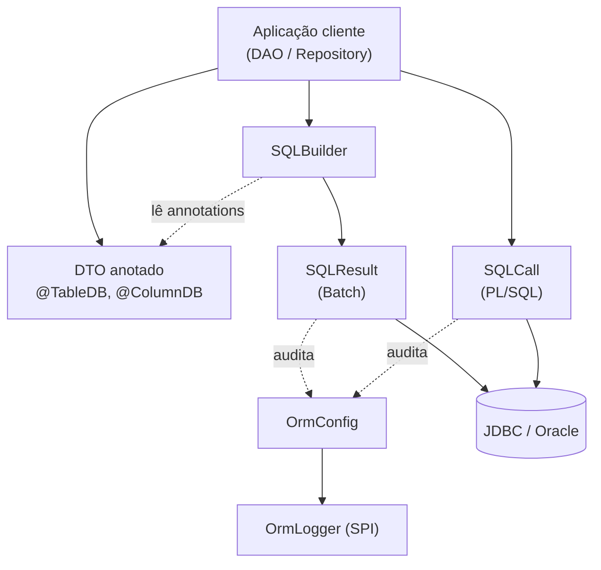
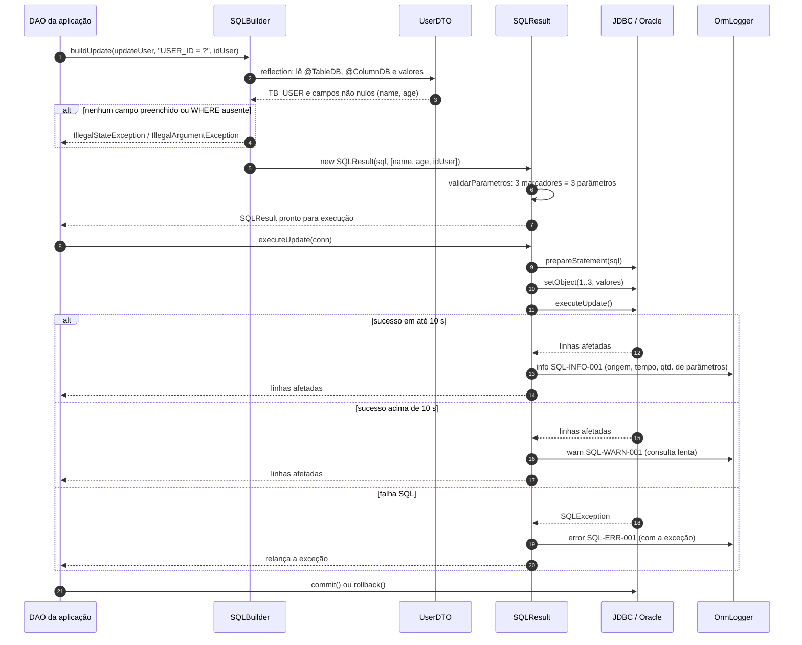
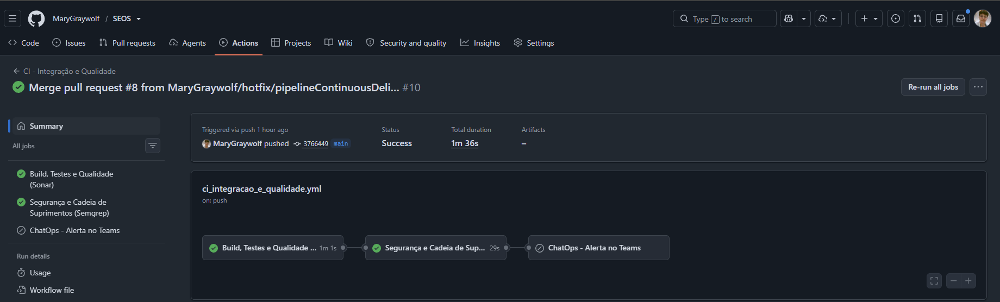
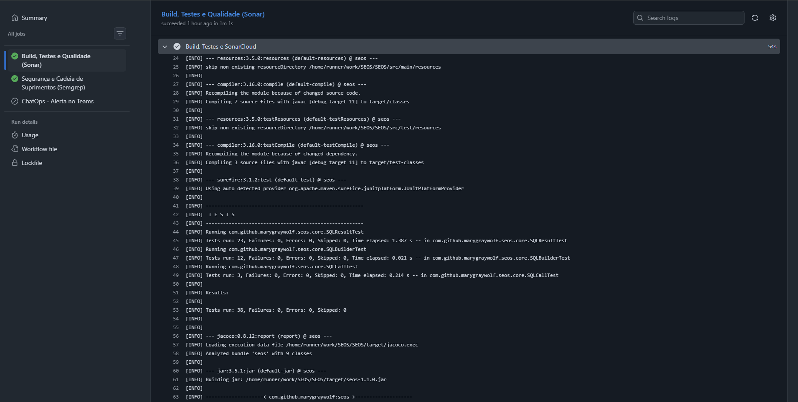
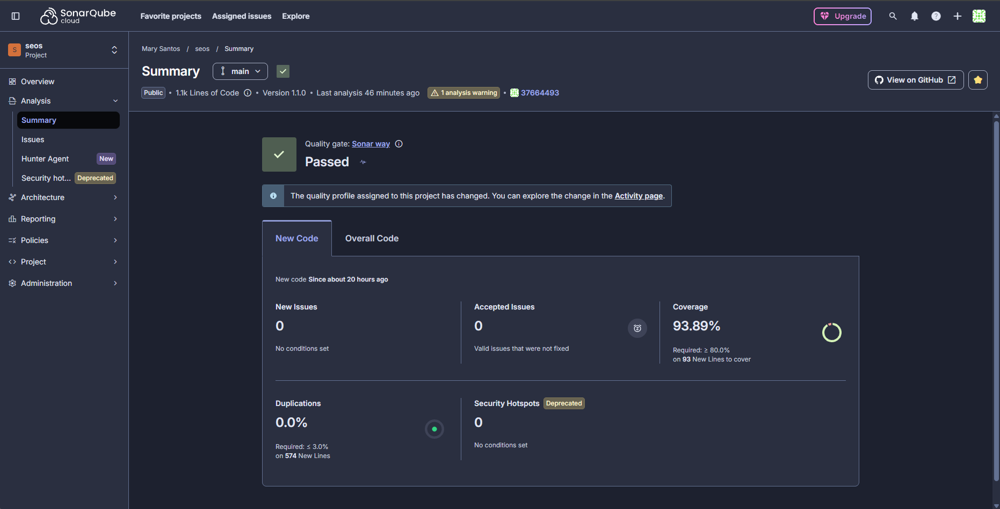
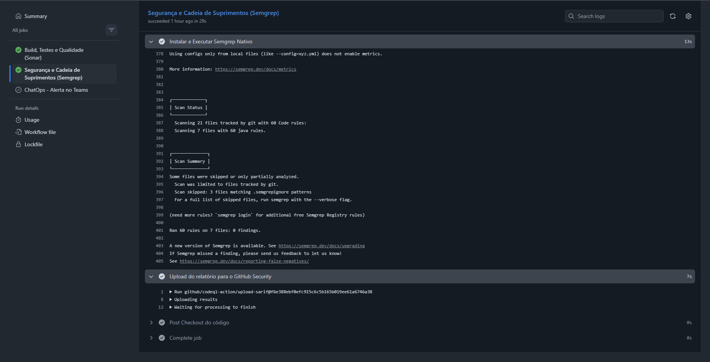
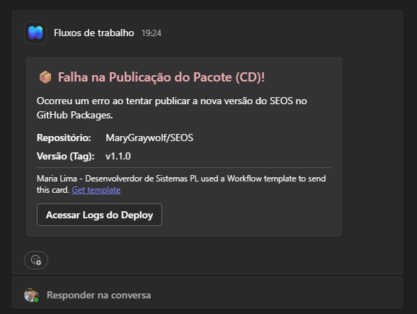
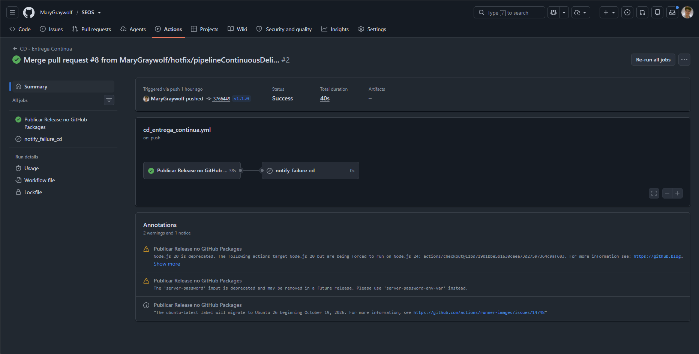
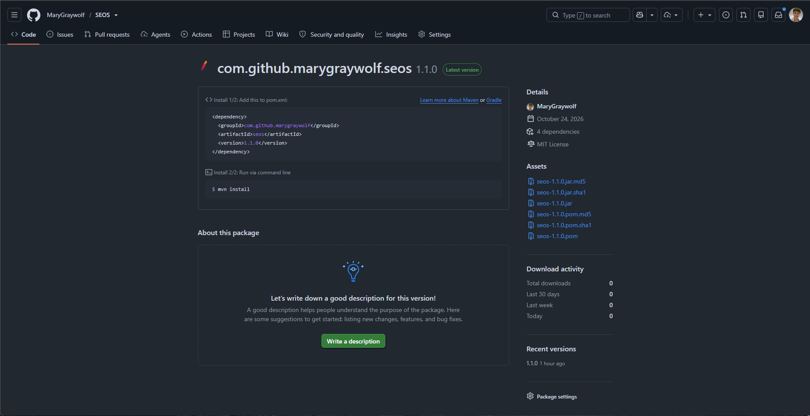

# Relatório de Projeto

## SEOS (_Software Endurance Orchestration System_): redução de _boilerplate_, auditoria e segurança cibernética na camada de persistência

**Autora:** Maria Antônia Santos de Lima  
**Instituição:** Fundação Edson Queiroz — Universidade de Fortaleza (UNIFOR)  
**Curso:** Pós-Graduação em Engenharia de Software com foco em DevOps  
**Local:** Fortaleza-CE  
**Ano:** 2026

## 1. Introdução

Na empresa estudada, os métodos de consulta usados nos projetos são longos e verbosos. Para realizar uma consulta, é necessário escrevê-la manualmente, armazená-la em uma variável, mapear os parâmetros do `PreparedStatement` e, logo em seguida, mapear o `ResultSet`, campo a campo.

Em alguns casos, as consultas não possuem parâmetros. Em outros, os valores são concatenados diretamente na instrução _Structured Query Language_ (SQL), o que torna a aplicação vulnerável a _SQL Injection_. Além disso, existem diversas versões de operações como `INSERT`, `UPDATE` e consultas para uma mesma tabela. Isso ocorre porque determinadas implementações precisam de estruturas específicas que não podem ser modificadas, resultando na duplicação de operações semelhantes.

Nesse contexto, foi desenvolvido o **SEOS** (_Software Endurance Orchestration System_), um _microframework_ de Mapeamento Objeto-Relacional (ORM, do inglês _Object-Relational Mapping_) criado para atender às necessidades específicas da empresa. O SEOS mapeia tabelas, campos e _sequences_ por meio de _annotations_ e constrói estruturas _Data Manipulation Language_ (DML) e _Data Query Language_ (DQL) com base nesses mapeamentos. Dessa forma, busca tornar o acesso ao banco de dados mais padronizado e seguro, além de retornar as classes com os valores já mapeados e prontos para serem utilizados pelas implementações. Neste trabalho, o SEOS é caracterizado como um _microframework_ quanto à sua proposta e referido como biblioteca quanto à sua forma de distribuição, um pacote `.jar` importado como dependência pelas aplicações.

### 1.1 Resumo

Os sistemas legados da empresa estudada, uma indústria do setor têxtil, acessam o banco de dados com consultas escritas à mão via JDBC. Ao longo dos anos, essa prática resultou em elevada duplicação de código, escassez de registros de _log_ e consultas expostas a _SQL Injection_: dos 2.890 métodos de persistência analisados nos dois sistemas principais, 582 foram classificados como vulneráveis. Para enfrentar esse problema, foi evoluído o SEOS, um _microframework_ em Java que monta as consultas de forma parametrizada a partir de _annotations_, converte os resultados em objetos automaticamente e registra cada execução, sem tirar da aplicação o controle sobre conexões e transações. O desenvolvimento da biblioteca seguiu a cultura _DevSecOps_, com testes automatizados, análise de qualidade e de segurança a cada alteração, alertas no Microsoft Teams e publicação versionada. Na avaliação conduzida no sistema de _e-commerce_, os métodos escritos com o SEOS apresentaram redução média de 48% no número de linhas, e a refatoração de 15 métodos legados reduziu o volume de código em 36,1%. Nas rotinas avaliadas, as concatenações de valores nas instruções SQL foram eliminadas e todas as execuções passaram a contar com auditoria. A esteira alcançou 90,3% de cobertura de testes, sem vulnerabilidades apontadas pela análise estática. Os resultados indicam que é possível tornar a camada de persistência mais segura e enxuta sem a adoção de um ORM completo, abordagem que se mostra adequada a cenários nos quais a aplicação precisa manter o controle das transações.

### 1.2 Objetivo

#### Objetivo geral

Evoluir o _microframework_ SEOS com base em práticas consolidadas de mercado e estruturar seu processo de desenvolvimento sob a cultura _DevSecOps_, a fim de demonstrar os ganhos de otimização, padronização, auditoria e segurança na camada de persistência.

#### Objetivos específicos

- Automatizar a geração de instruções DML e DQL e o mapeamento objeto-relacional de consultas por meio de _annotations_ e _reflection_;
- Mitigar os riscos de _SQL Injection_ na camada de persistência mediante a parametrização obrigatória dos valores e a validação estrutural das operações;
- Incorporar mecanismos de auditoria e observabilidade para o rastreamento de erros, origem, quantidade de parâmetros e tempo de execução das operações no banco de dados;
- Estruturar uma esteira _DevSecOps_ de Integração e Entrega Contínua (CI/CD, do inglês _Continuous Integration/Continuous Delivery_), contemplando testes automatizados, inspeção de qualidade e cobertura, análise estática de segurança (SAST, do inglês _Static Application Security Testing_), alertas via _ChatOps_ e publicação com versionamento semântico;
- Avaliar a aderência arquitetural do SEOS frente às restrições do cenário corporativo estudado em comparação com soluções tradicionais de mercado, como o Hibernate/_Java Persistence API_ (JPA);
- Mensurar os ganhos quantitativos e qualitativos da adoção da biblioteca em relação à escrita manual via _Java Database Connectivity_ (JDBC), considerando a redução de código, a eliminação de duplicações e a mitigação de vulnerabilidades baseadas no _Open Worldwide Application Security Project_ (OWASP) _Top_ 10.

### 1.3 Justificativa

Durante o desenvolvimento de uma demanda, o método de persistência existente não pôde ser reaproveitado, e seria necessário criar mais uma versão de um `UPDATE` com as mesmas condições. Essa situação suscitou o questionamento sobre a necessidade de duplicar uma operação já implementada e evidenciou que a **falta de padronização**, a **baixa qualidade do código** e os **problemas de segurança nas consultas** precisavam ser tratados.

O **SEOS** foi concebido a partir dessa necessidade, como uma solução capaz de reduzir o trabalho manual e a duplicação de métodos, facilitar a manutenção dos projetos empresariais e diminuir os riscos de _SQL Injection_, **sem retirar da equipe o controle** sobre as consultas, conexões e transações de persistência.

### 1.4 Problema

Em um diagnóstico inicial realizado junto à equipe de Arquitetura sobre uma única classe de acesso a dados (DAO, do inglês _Data Access Object_, também chamada de _Repository_) de um dos projetos legados da empresa, identificou-se um volume elevado de retrabalho e de vulnerabilidades. Ao todo, o arquivo concentrava **21.381 linhas de código** distribuídas em **409 métodos** (dos quais **402** acessam diretamente o banco de dados), com uma taxa de **19,6% de linhas idênticas** e **54,4% de linhas repetidas**. Além da duplicação, constatou-se que, entre **416 chamadas** a `PreparedStatement`, apenas **156** parametrizavam os valores adequadamente. Considerando os **402 métodos** que acessam o banco de dados, aproximadamente **43%** deles mostraram-se potencialmente vulneráveis a _SQL Injection_. Os alertas sobre essas falhas na camada de persistência já eram conhecidos internamente, mas a falta de uma abstração padronizada, a pressão por entregas rápidas e o tamanho dos sistemas legados inviabilizaram a correção manual desse código, cenário no qual o SEOS se insere.

Embora seja distribuído como uma biblioteca Java sob versionamento semântico, e não como uma aplicação final isolada, o SEOS opera no núcleo da camada de persistência dos módulos que sustentam a operação da empresa. No exemplo citado, ter cerca de **43% dos métodos suscetíveis a _SQL Injection_** representa um risco operacional direto ao banco de dados. Caso uma vulnerabilidade dessa natureza fosse explorada ou tabelas essenciais fossem corrompidas, a contenção do incidente, a auditoria dos registros afetados e a restauração do ambiente exigiriam várias horas de trabalho. Nesse período, a paralisação do faturamento e das vendas traria prejuízos financeiros diretos à organização, além de perdas indiretas, como desgaste reputacional e impacto no atendimento aos clientes. Assim, o uso do SEOS em conjunto com a esteira _DevSecOps_ e o controle estrito de versões atua na prevenção desses incidentes operacionais e financeiros.

## 2. Referencial Teórico

### 2.1 Qualidade de Código e Persistência de Dados em Sistemas Corporativos

A vida útil de um sistema corporativo depende da clareza e da facilidade de manutenção do seu código-fonte. Segundo Martin (2009), no Capítulo 17 de _Código Limpo_, a duplicação de código é um dos principais fatores de degradação estrutural de um _software_, pois multiplica os pontos de alteração e aumenta a chance de novos defeitos a cada demanda. Na camada de persistência de aplicações Java que utilizam JDBC manualmente, essa repetição aparece com frequência na abertura de conexões, no preenchimento sequencial de parâmetros, na leitura de resultados e no tratamento de exceções.

Ferramentas tradicionais de ORM buscam abstrair esse trabalho manual, mas sua adoção nem sempre é viável em sistemas legados acoplados a regras de negócio no banco de dados. Nos Capítulos 30 e 32 de _Arquitetura Limpa_, Martin (2019) defende que tanto o banco de dados quanto os _frameworks_ de mercado devem ser tratados como detalhes de infraestrutura, evitando que ferramentas opinativas assumam o controle sobre a arquitetura ou imponham acoplamento ao modelo da aplicação. De forma complementar, Richards e Ford (2020) definem como primeira lei da arquitetura de _software_ que toda decisão arquitetural envolve compensações (_trade-offs_). Conforme analisado por Ford _et al._ (2022), quando não há soluções universais prontas e diversos módulos compartilham contratos estritos sobre uma mesma base de dados, a engenharia de _software_ precisa equilibrar o nível de abstração desejado e o controle transacional exigido pela operação.

### 2.2 Segurança na Camada de Persistência e _SQL Injection_

A falta de padronização no acesso a dados dificulta a manutenção do código e expõe a organização a riscos de segurança cibernética. De acordo com a OWASP Foundation (2025), na edição 2025 do relatório _OWASP Top 10_, as falhas de injeção (_A05:2025 — Injection_) permanecem entre os riscos mais críticos em aplicações corporativas e _web_, ocorrendo quando dados não confiáveis são enviados a um interpretador como parte de um comando ou consulta.

Em bancos de dados relacionais, conforme a definição da fraqueza CWE-89 mantida pela MITRE Corporation ([s. d.]), o _SQL Injection_ ocorre quando a instrução SQL é construída com dados de origem externa sem a neutralização adequada de elementos especiais, como na concatenação direta de variáveis no texto da consulta, o que permite a um invasor alterar a lógica do comando para ler dados sigilosos, modificar registros ou contornar mecanismos de proteção. Como principal defesa na camada de aplicação, a OWASP Foundation ([s. d.]) recomenda o uso de consultas parametrizadas (_Prepared Statements_), nas quais a estrutura da instrução SQL é definida previamente e os parâmetros recebidos são tratados apenas como dados, sem serem interpretados como comando. Quando essa parametrização é centralizada na própria abstração de persistência, a equipe deixa de depender apenas de revisões manuais a cada novo método criado.

### 2.3 Cultura _DevSecOps_, Análise Estática (SAST) e Segurança da Cadeia de Suprimentos

Para que práticas de codificação segura sejam verificadas de forma contínua, a engenharia de _software_ evoluiu do modelo DevOps tradicional para a cultura _DevSecOps_. Segundo Souppaya, Scarfone e Dodson (2022), no _Secure Software Development Framework_ (SSDF) do _National Institute of Standards and Technology_ (NIST), as práticas de desenvolvimento seguro devem ser integradas a todas as fases do ciclo de vida do _software_, de modo que as vulnerabilidades sejam identificadas e corrigidas o mais cedo possível. A cultura _DevSecOps_ operacionaliza essa recomendação por meio da Segurança Antecipada (_Shift-Left Security_), que traz a detecção de vulnerabilidades para o início da esteira de CI/CD.

Essa automação baseia-se em ferramentas de SAST e em portões de qualidade (_Quality Gates_). No Capítulo 6 de sua obra, Richards e Ford (2020) classificam essas verificações automatizadas em _pipelines_ como funções de avaliação (_fitness functions_), que aferem se características arquiteturais como segurança, cobertura de testes e controle de duplicação estão sendo mantidas. No Brasil, pesquisas publicadas nos anais da Sociedade Brasileira de Computação (SBC) demonstram resultados práticos do uso dessas ferramentas: Milanez _et al._ (2025) aplicaram a detecção automatizada de falhas de código com base nas diretrizes da OWASP utilizando o _SonarQube_, enquanto Pimentel e Progetti (2025), ao compararem ferramentas SAST tradicionais como _Semgrep_ e _SonarQube_, registraram 100% de precisão na identificação de vulnerabilidades estruturais clássicas, incluindo _SQL Injection_. Já Machado, Cordeiro e Jandre (2026) destacam a necessidade de calibrar os portões de segurança nas esteiras _DevSecOps_ para barrar _builds_ vulneráveis sem causar fadiga de alertas (_alert fatigue_) na equipe.

Além da análise do código próprio, a segurança da esteira envolve a cadeia de suprimentos de _software_ (_Software Supply Chain Security_), tema que recebeu categoria própria na edição 2025 do OWASP _Top_ 10 (_A03:2025 — Software Supply Chain Failures_), abrangendo dependências, ferramentas de _build_ e _pipelines_ de CI/CD, e que se complementa pela categoria _A08:2025 — Software or Data Integrity Failures_, voltada à verificação da integridade de artefatos e atualizações (OWASP Foundation, 2025). Seguindo essa orientação, o guia de segurança do GitHub (2024) recomenda fixar todas as _actions_ de terceiros pelo _hash_ completo e imutável do _commit_ (SHA) em vez de utilizar _tags_ mutáveis, o que evita a execução de código alterado em dependências externas durante o _build_ e a publicação de pacotes.

### 2.4 Observabilidade, Auditoria e Resposta a Incidentes

A operação segura de sistemas críticos também exige visibilidade sobre o que ocorre em tempo de execução. No Capítulo 7 de _Código Limpo_, Martin (2009) afirma que o tratamento de erros deve informar contexto suficiente para identificar a origem e a localização de uma falha, evitando blocos de captura que escondam exceções ou atrasem o diagnóstico. Na área de segurança, a categoria _A09:2025 — Security Logging and Alerting Failures_ (OWASP Foundation, 2025) mostra que a falta de registros de auditoria e de alertas ativos dificulta a identificação de falhas e amplia o impacto de incidentes em produção. Em complemento, a categoria _A10:2025 — Mishandling of Exceptional Conditions_, introduzida nessa edição, trata das falhas no tratamento de erros e de condições anormais, como exceções suprimidas ou que deixam o sistema em estado inconsistente, em consonância com a recomendação de Martin (2009).

Por isso, combinar o registro padronizado de erros e de tempo de execução na camada de persistência com o envio de alertas direcionados na esteira de integração contínua, evitando a fadiga de alertas apontada por Machado, Cordeiro e Jandre (2026), oferece à equipe técnica os dados necessários para corrigir falhas rapidamente e acompanhar o ciclo de vida do _software_.

## 3. Caso de Uso

### 3.1 Contexto do Trabalho

O cenário utilizado como base para o desenvolvimento e a aplicação do SEOS é o de uma empresa têxtil que mantém dois projetos legados principais. Ambos foram desenvolvidos em Java (nas versões 8 e 11), acessam diretamente o banco de dados Oracle 19c via JDBC e comunicam-se por _Application Programming Interface_ (API) com o sistema de _Enterprise Resource Planning_ (ERP) que gerencia os processos empresariais. Por razões de confidencialidade e políticas internas de segurança da informação, a identidade da empresa e seus indicadores corporativos globais são preservados neste relatório, mantendo o foco na análise técnica de engenharia de _software_.

Esses dois sistemas sustentam rotinas críticas de diferentes áreas da empresa: um atende às automações produtivas, logísticas e contábeis, e o outro responde pelo _e-commerce_, somando um grande volume de consultas e operações de persistência criadas ao longo dos anos. Pela forma como foram integrados ao ERP, as consultas, as conexões e as transações precisam permanecer sob controle direto da aplicação, o que inviabilizava o uso de um ORM tradicional que gerenciasse o ciclo de persistência de maneira automática.

Como esses sistemas evoluíram por vários anos passando por diferentes desenvolvedores e demandas urgentes de negócio, manter a escrita SQL manual segura e uniforme sem uma ferramenta centralizadora tornou-se difícil na rotina da equipe. Por isso, o SEOS foi projetado como uma biblioteca leve, compatível tanto com o Java 8 quanto com o Java 11, capaz de se integrar aos projetos existentes sem exigir mudanças na arquitetura da empresa.

### 3.2 Situação Atual

Antes do SEOS, não havia padronização na camada de persistência dos dois sistemas. O desenvolvedor precisava escrever cada instrução SQL manualmente, definir os parâmetros via `PreparedStatement` ou por concatenação, percorrer o `ResultSet` campo a campo e tratar possíveis erros por conta própria. Muitas vezes, métodos parecidos eram copiados e adaptados para acelerar uma entrega, replicando falhas já existentes no código. Para medir o alcance desse problema na totalidade dos dois projetos legados, ampliando o diagnóstico inicial daquele arquivo isolado apresentado na Seção 1.4, foi feito um levantamento junto à equipe de Arquitetura sobre todos os métodos que interagem com o banco de dados, totalizando **2.890 métodos** entre as duas aplicações.

No primeiro sistema, voltado às automações corporativas (produtivas, logísticas e contábeis), foram analisados **1.641 métodos** de acesso ao banco, conforme apresentado na Tabela 1:

#### Tabela 1 — Levantamento de métodos de persistência no sistema de automações corporativas

| #   | Indicador                                                                            | Quantidade | % dos 1.641 |
| --- | ------------------------------------------------------------------------------------ | ---------- | ----------- |
| 1   | Métodos que realizam funções no banco                                                | 1.641      | 100%        |
| 2   | Usam conexão JDBC (`PreparedStatement`, `CallableStatement`, `getPreparedStatement`) | 1.321      | 80,5%       |
| 3   | Não usam JDBC direto                                                                 | 320        | 19,5%       |
| 4   | Com alguma má prática de consulta                                                    | **395**    | **24,1%**   |
| 5   | Vulneráveis (concatenam `String` ou tipo não resolvido)                              | **283**    | **17,2%**   |
| 6   | Sem nenhuma chamada de _log_                                                         | **573**    | **34,9%**   |

**Fonte:** Elaborada pela autora (2026).

Dos **573 métodos sem _logs_**, **254** possuem `try/catch` mas não registram _logs_ de erro ou de sucesso, **58** só aplicam `System.out` ou `printStackTrace` e **28** possuem vulnerabilidades. Já no segundo sistema, responsável pelo _e-commerce_, o cenário mostrou-se ainda mais crítico quanto à exposição a _SQL Injection_ e à falta de rastreabilidade, conforme demonstrado na Tabela 2:

#### Tabela 2 — Levantamento de métodos de persistência no sistema de _e-commerce_

| #   | Indicador                                                  | Quantidade | % dos 1.249 |
| --- | ---------------------------------------------------------- | ---------- | ----------- |
| 1   | Métodos que fazem operações no banco                       | 1.249      | 100%        |
| 2   | Usam JDBC (`prepareStatement`, `prepareCall`, `ResultSet`) | 1.229      | 98,4%       |
| 3   | Não usam JDBC (JPA/Hibernate via `EntityManager`)          | 20         | 1,6%        |
| 4   | Fora das boas práticas (concatenam variáveis na SQL)       | **468**    | **37,5%**   |
| 5   | Vulneráveis a _SQL Injection_                              | **299**    | **23,9%**   |
| 6   | Sem auditoria de _logs_                                    | **1.179**  | **94,4%**   |

**Fonte:** Elaborada pela autora (2026).

A seguir, apresenta-se um exemplo representativo do padrão de código que alimentou os dados desses levantamentos:

```java
public List<Usuario> consultarUsuarios(String status, Integer idadeMinima) {
    List<Usuario> listaResultado = new ArrayList<>();

    String dql = "SELECT USER_ID, USER_NAME, USER_AGE, STATUS "
            + "FROM TB_USER WHERE 1=1 ";

    if (status != null && !status.isEmpty()) {
        dql += " AND STATUS = '" + status + "'";
    }
    if (idadeMinima != null) {
        dql += " AND USER_AGE >= " + idadeMinima;
    }

    try (Connection conn = DriverManager.getConnection(URL, USER, PASSWORD);
         PreparedStatement ps = conn.prepareStatement(dql);
         ResultSet rs = ps.executeQuery()) {

        while (rs.next()) {
            Long id = rs.getLong("USER_ID");
            String nome = rs.getString("USER_NAME");
            Integer idade = rs.getInt("USER_AGE");
            String statusRetornado = rs.getString("STATUS");

            Usuario usuario = new Usuario();
            usuario.setId(id);
            usuario.setNome(nome);
            usuario.setIdade(idade);
            usuario.setStatus(statusRetornado);
            listaResultado.add(usuario);
        }
    } catch (SQLException e) {
        System.err.println("Erro ao executar consulta: " + e.getMessage());
        e.printStackTrace();
    }
    return listaResultado;
}
```

Os dados das Tabelas 1 e 2, somados ao código anterior, mostram como o padrão de acesso a dados acumulado nesses sistemas se tornou extenso e vulnerável. Além da repetição de código estrutural, a concatenação direta de variáveis na instrução SQL dificulta a padronização e expõe a aplicação a ataques de _SQL Injection_, enquanto a coexistência de múltiplos métodos semelhantes e a falta de _logs_ de auditoria encarecem a manutenção.

### 3.3 Solução Proposta

Diante dos números levantados na seção anterior, que apontaram o excesso de código manual, o risco de _SQL Injection_ e a falta de _logs_ nos dois sistemas da empresa, foi idealizado o **SEOS**: um _microframework_ de ORM em Java criado para corrigir essas falhas respeitando a arquitetura existente, sem adicionar complexidade ao desenvolvimento.

A proposta do SEOS é automatizar a parte mecânica e propensa a erros do uso do JDBC. Em vez de o desenvolvedor repetir manualmente todo o ciclo de preparação e leitura de dados em cada método, a biblioteca assume a montagem segura das instruções, a validação dos parâmetros e a auditoria das execuções, devolvendo os objetos já preenchidos sem retirar da aplicação o controle explícito sobre a conexão e a transação.

Para que essa automação funcione na prática, o ponto de partida do SEOS é o mapeamento das tabelas e dos campos diretamente nas classes de Objeto de Transferência de Dados (DTO, do inglês _Data Transfer Object_) por meio de _annotations_. O modelo foi inspirado no mapeamento do JPA/Spring Boot, mas aplicado diretamente aos DTOs por meio das interfaces próprias `@TableDB` e `@ColumnDB`.

A anotação `@TableDB` identifica o nome da tabela ou da _view_ criada no banco de dados, enquanto a `@ColumnDB` informa o nome da coluna correspondente, define se o campo é uma _primary key_ e indica se possui _sequences_. As _sequences_ declaradas entram automaticamente nos construtores de `INSERT`, e os atributos da classe que não possuem `@ColumnDB` são ignorados pelas demais funcionalidades do SEOS, conforme demonstrado a seguir:

```java
@TableDB(name = "TB_USER")
public class UserDTO {

    @ColumnDB(
        localName = "USER_ID",
        sequence = "SEQ_TB_USER.NEXTVAL",
        isPrimaryKey = true
    )
    private Long id;

    @ColumnDB(localName = "USER_NAME")
    private String name;

    @ColumnDB(localName = "STATUS")
    private String status;

    @ColumnDB(localName = "USER_AGE")
    private Integer age;
}
```

Com as classes configuradas, é possível utilizar a segunda função da ferramenta, o `SQLBuilder`, que lê as _annotations_ via _reflection_ e monta automaticamente os comandos SQL de DQL e DML. A geração do `SELECT` pode montar uma consulta com todos os campos mapeados da classe de forma direta (`buildSelect`) ou retornar campos específicos de forma fluente (`select`) por meio do método `.campos()`, no qual se informam os nomes dos atributos Java da classe, funcionando da mesma maneira para a cláusula de filtro com `.where()`:

```java
// 1. Geração direta com todos os campos mapeados da classe:
SQLBuilder.buildSelect(UserDTO.class, "STATUS = ?", status);

// 2. Geração fluente selecionando campos específicos da classe:
SQLBuilder.select(UserDTO.class)
          .campos("id", "name")
          .where("STATUS = ?", status)
          .build();
```

Para as operações DML (`INSERT` e `UPDATE`), o `SQLBuilder` aplica o conceito de _Anti-Null_: apenas os atributos que estiverem preenchidos serão persistidos no banco. Dessa forma, não é mais preciso desenvolver métodos diferentes para a mesma tabela, sendo necessário apenas informar a classe com as informações preenchidas.

Quando é utilizado o _builder_ de `INSERT` (`buildInsert`) sem preencher os dados da _primary key_, automaticamente é utilizada a _sequence_ configurada anteriormente no `@ColumnDB`, sendo também possível realizar inserções em lote por meio do método `buildInsertBatch()`:

```java
UserDTO newUser = UserDTO.builder()
                         .name("Maria")
                         .status("ATIVO")
                         .build();

SQLBuilder.buildInsert(newUser);

// Instrução SQL conceitual gerada internamente:
// INSERT INTO TB_USER (USER_ID, USER_NAME, STATUS) VALUES (SEQ_TB_USER.NEXTVAL, ?, ?)
```

Já no _builder_ de `UPDATE` (`buildUpdate`), a ferramenta só dá continuidade à função se, e somente se, forem informadas as condições de filtro (`WHERE`). Sem essa parametrização, é lançada uma exceção ao desenvolvedor, impedindo modificações acidentais sem filtro no banco de dados:

```java
UserDTO updateUser = UserDTO.builder()
                         .name("Maria Antônia")
                         .age(26)
                         .build();

SQLBuilder.buildUpdate(updateUser, "USER_ID = ?", idUser);

// Instrução SQL conceitual gerada internamente:
// UPDATE TB_USER SET USER_NAME = ?, USER_AGE = ? WHERE USER_ID = ?
```

Os comandos DQL e DML construídos, juntamente com a lista ordenada de parâmetros, são encapsulados na classe `SQLResult`. Nela são centralizados o preenchimento seguro dos valores no `PreparedStatement` e o mapeamento dos dados retornados pelo `ResultSet` para as classes configuradas com `@ColumnDB`, além de ser validado previamente se a quantidade de parâmetros informados corresponde à quantidade de _placeholders_ (`?`) existentes nos comandos SQL.

Nas operações de escrita (`INSERT` e `UPDATE`), o `SQLResult` oferece três formas principais de execução, adaptadas à necessidade de cada rotina: a atualização direta retornando o total de registros afetados, a inserção com recuperação imediata do identificador gerado pela _sequence_ do Oracle (preenchendo automaticamente a chave primária no próprio objeto enviado) e o processamento em lote para grandes volumes de dados. Em todas essas modalidades, a conexão JDBC parte sempre do chamador, garantindo que o controle transacional (`commit` e `rollback`) permaneça sob domínio exclusivo da aplicação, enquanto a biblioteca se encarrega de fechar internamente os recursos de preparação e leitura:

```java
// 1. Atualização retornando a quantidade de linhas afetadas:
int linhasAtualizadas = SQLBuilder
    .buildUpdate(updateUser, "USER_ID = ?", idUser)
    .executeUpdate(conn);

// 2. Inserção retornando o ID gerado pela sequence (e preenchendo newUser.id):
Long idGerado = SQLBuilder
    .buildInsert(newUser)
    .executeAndReturnId(conn, newUser);

// 3. Inserção em lote com controle transacional explícito pelo chamador:
boolean autoCommitOriginal = conn.getAutoCommit();
try {
    conn.setAutoCommit(false);
    int[] resultados = SQLBuilder.buildInsertBatch(newUsers).executeBatch(conn);
    conn.commit();
} catch (Exception e) {
    conn.rollback();
    throw e;
} finally {
    conn.setAutoCommit(autoCommitOriginal);
}
```

Nas operações de leitura (`SELECT`), o principal gargalo dos sistemas legados era a repetição de laços manuais para extrair coluna por coluna do `ResultSet`, independentemente do formato do retorno. Para eliminar esse trabalho repetitivo quando a consulta envolve tabelas mapeadas, o `SQLResult` converte os registros retornados pelo banco diretamente em uma lista de objetos tipados ou em uma instância única (voltada a buscas pontuais, como consultas por chave primária). Além disso, para facilitar a migração gradual de classes legadas que ainda montam a consulta manualmente, a biblioteca permite reaproveitar apenas o seu motor de mapeamento sobre um resultado já aberto:

```java
// 1. Retorno de lista de objetos mapeados:
List<UserDTO> users = SQLBuilder
    .buildSelect(UserDTO.class, "STATUS = ?", status)
    .executeQuery(conn, UserDTO.class);

// 2. Retorno de um único objeto (ou null se não encontrado):
UserDTO user = SQLBuilder
    .buildSelect(UserDTO.class, "USER_ID = ? AND STATUS = ?", idUser, status)
    .executeQuerySingle(conn, UserDTO.class);

// 3. Aproveitamento do mapeamento em consultas legadas com ResultSet aberto:
try (PreparedStatement ps = conn.prepareStatement(sql);
     ResultSet rs = ps.executeQuery()) {
    return new SQLResult(sql, Collections.emptyList()).mapearResultSet(rs, UserDTO.class);
}
```

Por outro lado, em rotinas de relatórios, totalizadores ou consultas parciais nas quais a criação de uma classe DTO específica seria desnecessária, o `SQLResult` permite extrair os dados diretamente em estruturas dinâmicas do próprio Java. Nesses cenários, o resultado pode ser retornado como listas ou linhas únicas em formato de mapa (indexadas pelo nome da coluna), como um dicionário de chave e valor a partir de consultas de duas colunas, ou ainda como um valor escalar único já convertido para o tipo numérico ou textual esperado pela aplicação:

```java
// 1. Consulta agregada retornando lista de mapas (sem necessidade de DTO):
List<Map<String, Object>> totaisPorStatus = new SQLResult(
    "SELECT STATUS, COUNT(1) TOTAL FROM TB_USER GROUP BY STATUS",
    Collections.emptyList()
).executeQueryAsMap(conn);

// 2. Projeção parcial de uma única linha em mapa:
Map<String, Object> dadosParciais = new SQLResult(
    "SELECT USER_NAME, STATUS FROM TB_USER WHERE USER_ID = ?",
    Arrays.asList(idUser)
).executeQueryAsSingleMap(conn);

// 3. Mapeamento direto de duas colunas em dicionário (chave -> valor):
Map<Long, String> nomesPorId = new SQLResult(
    "SELECT USER_ID, USER_NAME FROM TB_USER WHERE STATUS = ?",
    Arrays.asList("ATIVO")
).executeAsDictionary(conn);

// 4. Retorno de valor escalar único com conversão automática de tipo:
Integer totalAtivos = new SQLResult(
    "SELECT COUNT(1) FROM TB_USER WHERE STATUS = ?",
    Arrays.asList("ATIVO")
).executeScalar(conn, Integer.class);
```

Além das instruções SQL tradicionais, o banco Oracle 19c integrado ao ERP concentra diversas regras de negócio em _procedures_ e _packages_ escritas em _Procedural Language/Structured Query Language_ (PL/SQL). Na abordagem tradicional do JDBC, a chamada dessas rotinas exigia o controle manual da posição numérica de cada parâmetro de entrada e saída, aumentando a incidência de erros de manutenção. Para simplificar esse fluxo, a classe `SQLCall` introduz uma escrita fluente na qual os parâmetros são declarados de forma encadeada e associados a apelidos legíveis (_aliases_), permitindo recuperar os valores retornados pela _procedure_ pelo nome, e não mais por índices numéricos:

```java
SQLCall.Result resultado = SQLCall
    .name("PKG_USER.PROCESSAR_CADASTRO")
    .in(newUser.getName())
    .inOut("STATUS_ATUAL", newUser.getStatus(), Types.VARCHAR)
    .out("ID_GERADO", Types.NUMERIC)
    .execute(conn);

Long idGerado = resultado.getLong("ID_GERADO");
String statusFinal = resultado.getString("STATUS_ATUAL");
```

Por fim, para resolver a falta de rastreabilidade apontada na Seção 3.2, na qual **34,9%** dos métodos do sistema de automações e **94,4%** dos métodos do _e-commerce_ não possuíam nenhum registro de _log_, o SEOS incorporou uma camada transversal de auditoria baseada na interface _Service Provider Interface_ (SPI) `OrmLogger`, gerenciada pela classe `OrmConfig`. Com essa estrutura, todas as operações executadas pela biblioteca têm seu tempo de resposta medido e identificam automaticamente a classe e o método da aplicação que originaram a chamada ao banco. Cada execução gera um registro padronizado com a origem, a duração e a contagem de parâmetros: informativo em caso de sucesso, de alerta quando a operação ultrapassa o limite de tempo configurado (**10 segundos** para consultas e **5 segundos** para chamadas PL/SQL) e de erro em caso de falha SQL, permitindo que a aplicação conecte seu próprio sistema de _logs_ na inicialização. Esse comportamento corresponde à versão `v1.2.0`; na versão `v1.1.0`, utilizada no piloto descrito na Seção 3.10, eram registradas apenas as falhas e as execuções lentas, com limite de 3 segundos para chamadas PL/SQL. O Quadro 10 ilustra a integração do _logger_ da aplicação:

```java
// Integração opcional do logger da aplicação com a auditoria automática do SEOS:
OrmConfig.setLogger(new OrmLogger() {
    @Override
    public void info(String origin, String code, String msg, Object... params) {
        appLogger.info("{} [{}] {}", origin, code, msg);
    }

    @Override
    public void warn(String origin, String code, String msg, Object... params) {
        appLogger.warn("{} [{}] {}", origin, code, msg);
    }

    @Override
    public void error(String origin, String code, String msg, Exception e, Object... params) {
        appLogger.error("{} [{}] {}", origin, code, msg, e);
    }
});
```

### 3.4 Arquitetura e Requisitos

A Figura 1 apresenta os componentes do SEOS e as dependências entre eles. A aplicação cliente fornece o DTO anotado e a `Connection` JDBC. O `SQLBuilder` interpreta as _annotations_ por meio de _reflection_ e produz um `SQLResult`, que executa o comando, mapeia o retorno e aciona a auditoria. O `SQLCall` desempenha função análoga para procedimentos PL/SQL. Ambos registram eventos pela interface `OrmLogger`, configurada na classe `OrmConfig`.

#### Figura 1 — Diagrama de componentes do SEOS



**Fonte:** Elaborada pela autora (2026).

A Figura 2 detalha, em ordem cronológica, uma execução completa de `UPDATE`, do DTO preenchido pela aplicação até o banco de dados e o registro do evento de auditoria. O fluxo mostra em que momento cada validação acontece: a ausência de campos preenchidos ou de cláusula `WHERE` interrompe a montagem ainda no `SQLBuilder`, e a divergência entre marcadores `?` e parâmetros é barrada na criação do `SQLResult`, antes de qualquer acesso ao banco. Como essas validações ocorrem antes do envio ao banco, as exceções correspondentes são lançadas diretamente à aplicação, sem registro de auditoria pelo SEOS. Depois da execução, o evento é classificado como sucesso, lentidão ou falha, e o controle da transação volta à aplicação.

#### Figura 2 — Diagrama de sequência de uma operação `UPDATE` com o SEOS



**Fonte:** Elaborada pela autora (2026).

Os requisitos funcionais (RF) e não funcionais (RNF) do SEOS são apresentados nas Tabelas 3 e 4, cada um associado à evidência que o sustenta e, no caso dos não funcionais, a uma meta. O desempenho sob carga não foi medido neste trabalho; as metas correspondentes referem-se aos limites configurados na biblioteca, e sua validação empírica permanece como proposta de trabalho futuro.

#### Tabela 3 — Requisitos funcionais do SEOS

| ID | Requisito | Evidência |
| :--- | :--- | :--- |
| RF01 | Mapear tabelas, colunas, _primary key_ e _sequences_ por _annotations_ no DTO. | `@TableDB` e `@ColumnDB` (Quadro 2). |
| RF02 | Gerar `SELECT` com todos os campos ou campos específicos, com filtro parametrizado. | `buildSelect` e `select().campos().where()` (Quadro 3); `SQLBuilderTest`. |
| RF03 | Gerar `INSERT` e `UPDATE` apenas com os atributos preenchidos (_Anti-Null_), usando a _sequence_ quando a _primary key_ é omitida. | `buildInsert` e `buildUpdate` (Quadros 4 e 5); `SQLBuilderTest`. |
| RF04 | Permitir a inserção em lote. | `buildInsertBatch` e `Batch.executeBatch` (Quadro 6). |
| RF05 | Preencher o `PreparedStatement` e validar que a quantidade de parâmetros corresponde à de _placeholders_. | `SQLResult.validarParametros` e `setParameters`; `SQLResultTest`. |
| RF06 | Devolver o resultado como lista de DTOs, objeto único, escalar, mapa ou dicionário. | `executeQuery`, `executeQuerySingle`, `executeScalar`, `executeQueryAsMap`, `executeAsDictionary` (Quadro 7). |
| RF07 | Retornar o número de linhas afetadas e o ID gerado pela _sequence_. | `executeUpdate` e `executeAndReturnId` (Quadro 6). |
| RF08 | Chamar procedimentos PL/SQL com parâmetros de entrada, saída e entrada/saída. | `SQLCall.in`, `out`, `inOut` e `execute`; `SQLCallTest`. |
| RF09 | Utilizar a conexão e o controle transacional da aplicação, sem abri-la nem encerrá-la. | Métodos `execute*(Connection)`; Quadro 6. |
| RF10 | Registrar cada execução, inclusive em lote, com origem, duração e quantidade de parâmetros, classificando-a como sucesso, lentidão ou falha, e permitir substituir o _logger_. | `auditarPerformance`, `OrmLogger` e `OrmConfig.setLogger` (Quadro 10); registro de sucesso e de lotes a partir da `v1.2.0`. |

**Fonte:** Elaborada pela autora (2026).

#### Tabela 4 — Requisitos não funcionais do SEOS

| ID | Requisito | Meta | Evidência |
| :--- | :--- | :--- | :--- |
| RNF01 | Segurança: valores nunca concatenados à instrução SQL. | Nenhum achado de _SQL Injection_ no código do SEOS. A cláusula `WHERE`, recebida como texto, é segura apenas quando a aplicação utiliza marcadores `?`. | Uso exclusivo de _placeholders_; varredura do Semgrep sem achados e matriz OWASP A05 (Tabela 10). |
| RNF02 | Rastreabilidade: auditoria de todas as execuções no banco. | Registro em 100% das execuções enviadas ao banco (sucesso, lentidão e falha), a partir da `v1.2.0`; exceções de validação anteriores à execução são lançadas à aplicação sem registro. | `auditarPerformance`, eventos `info`, `warn` e `error`; na `v1.1.0`, avaliada no piloto, cobertura de 100% para falhas e lentidão (Seção 3.11). |
| RNF03 | Desempenho: alerta de lentidão. | Aviso acima de 10 s (consultas) e 5 s (PL/SQL), a partir da `v1.2.0` (3 s para PL/SQL na `v1.1.0`). | `auditarPerformance`; desempenho sob carga não avaliado. |
| RNF04 | Confidencialidade dos _logs_. | Valores dos parâmetros ausentes dos eventos emitidos, inclusive os de sucesso. | `OrmConfig.DefaultConsoleLogger` (A09 da Tabela 10). |
| RNF05 | Compatibilidade: ausência de contêiner ou _runtime_ adicional. | Dependência apenas do JDBC; distribuição em `.jar`. | Tabela 5. |
| RNF06 | Manutenibilidade: qualidade verificada na esteira. | Aprovação em _build_, testes, SonarQube e SAST a cada _commit_. | Tabela 6; Seção 3.11. |

**Fonte:** Elaborada pela autora (2026).

### 3.5 Registro de Eventos e LGPD

O SEOS não armazena registros em seu código-fonte: os eventos são emitidos por meio da interface `OrmLogger` e repassados à aplicação que importa a biblioteca, a qual os grava no servidor conforme a configuração adotada. Na ausência de um _logger_ configurado, o SEOS utiliza um mecanismo de contingência que escreve no console, cujo destino também depende do servidor.

Os eventos emitidos (sucesso, lentidão e falha) contêm apenas a origem da chamada, o tempo de execução e a quantidade de parâmetros (e o nome da _procedure_, nas chamadas PL/SQL), sem os valores dos parâmetros. Esse conteúdo está alinhado ao princípio da necessidade da Lei Geral de Proteção de Dados Pessoais (LGPD) (Brasil, 2018, art. 6º, III), por restringir o registro ao mínimo necessário para auditoria e diagnóstico, de modo que os dados pessoais não são registrados pela biblioteca.

Permanece, contudo, a possibilidade de que a mensagem da exceção repassada ao _logger_ contenha trechos da instrução ou de dados, a depender do _driver_ do banco. Recomenda-se que a aplicação filtre ou mascare essa mensagem, restrinja o acesso aos arquivos de _log_ e defina o prazo de retenção segundo a política de segurança da empresa.

### 3.6 Impacto de um Incidente de _SQL Injection_

O impacto de um incidente de _SQL Injection_ pode ser descrito por suas categorias de custo. O custo direto decorre da paralisação do faturamento e das vendas durante a contenção do incidente, a auditoria dos registros afetados e a restauração do ambiente, etapas que, conforme o diagnóstico apresentado na Seção 1.4, exigiriam várias horas de trabalho. O custo indireto compreende a perda de clientes, o desgaste reputacional e o impacto no atendimento. Havendo exposição de dados pessoais, soma-se ainda o risco de sanções administrativas previstas na LGPD (Brasil, 2018, art. 52). Em contrapartida, a redução da exposição a esse tipo de ataque, pelo uso de parâmetros nas instruções, tem custo de implantação restrito ao esforço de adoção da biblioteca.

### 3.7 Comparação com Hibernate/JPA

Para fundamentar a construção de uma biblioteca híbrida própria em vez da adoção direta de uma ferramenta tradicional de mercado no cenário estudado, foi realizada uma comparação arquitetural com o Hibernate, uma das soluções ORM mais utilizadas no ecossistema Java, conforme sintetizado na Tabela 5:

#### Tabela 5 — Comparação arquitetural entre o Hibernate/JPA e o SEOS

| Requisito do projeto         | Hibernate / JPA                                                                         | SEOS híbrido JDBC                                                                  | Adequação ao cenário atual                                       |
| ---------------------------- | --------------------------------------------------------------------------------------- | ---------------------------------------------------------------------------------- | ---------------------------------------------------------------- |
| Integração com conexões ERP  | Requer configurar e integrar o contexto de persistência ao ciclo da plataforma.         | Recebe diretamente a `Connection` já fornecida pela aplicação.                     | O SEOS preserva o modelo operacional existente.                  |
| Previsibilidade das escritas | O resultado depende do estado da entidade, do contexto e das configurações de `flush`.  | Cada chamada representa um comando visível, sem sincronização implícita posterior. | O SEOS facilita a rastreabilidade nos projetos.                  |
| SQL Oracle específico        | Pode ser usado por SQL nativo, paralelamente ao modelo de entidades.                    | É parte natural da API e permanece concentrado na camada de _Repository_.          | O SEOS evita manter duas formas de consulta para o mesmo módulo. |
| CRUD (_Create, Read, Update, Delete_) de tabelas customizadas | Exige mapear entidades e configurar o ambiente JPA.                                     | Exige DTO anotado e _builders_ diretos.                                            | O SEOS atende com menor superfície de configuração.              |
| Atualizações parciais        | Possui alternativas como entidade gerenciada, consultas específicas e `@DynamicUpdate`. | A estratégia _Anti-Null_ transforma o DTO parcial diretamente no `SET`.            | O SEOS expressa de forma simples o padrão recorrente do projeto. |
| Controle transacional        | Integra-se a JTA, Spring e outros gerenciadores quando disponíveis.                     | Usa `commit`, `rollback` e conexão definidos pelo chamador.                        | O SEOS participa do limite transacional adotado pelo projeto.    |
| Consultas e projeções        | Oferece JPQL, Criteria, SQL nativo e projeções.                                         | Oferece DTO, resultado único, escalar, mapa, dicionário e SQL explícito.           | A API atual cobre os formatos utilizados pelos DAOs.             |
| Relacionamentos de domínio   | Automatiza associações, cascatas e estratégias de carregamento.                         | Mantém _joins_ e composição de resultados explícitos.                              | O escopo atual privilegia operações objetivas.                   |
| Dependências e inicialização | Requer o _runtime_ e a configuração do provedor ORM.                                    | Utiliza JDBC e poucas classes utilitárias já incorporadas ao projeto.              | O SEOS acrescenta baixo _overhead_ à implantação.                |
| Diagnóstico                  | Possui ecossistema de _logs_ e métricas, sujeito à configuração adotada.                | Concentra SQL e parâmetros e audita sucesso, lentidão, falhas e origem de cada execução. | A observabilidade atende ao diagnóstico necessário.              |

**Fonte:** Elaborada pela autora (2026).

### 3.8 Vantagens e desvantagens

A principal vantagem de adotar o SEOS é tornar as operações em banco de dados mais simples, auditáveis e seguras, sem interferir no controle interno de conexões JDBC e com baixo impacto esperado sobre o desempenho da aplicação, uma vez que a biblioteca não adiciona camadas de _cache_, sessão ou sincronização implícita. Como seus métodos automatizam a parametrização das consultas e mapeiam os resultados via _reflection_, o risco de expor o sistema a ataques de _SQL Injection_ é reduzido. Com isso, a arquitetura da biblioteca apoia-se em quatro pilares: padronização, simplificação, proteção e reutilização.

Em contrapartida, por ter uma proposta enxuta frente a um ORM completo como o Hibernate/JPA, o SEOS foca em operações diretas por tabela e não inclui recursos avançados de modelo de domínio, como o mapeamento automático de relacionamentos entre entidades (`@OneToMany`, `@ManyToOne`), o carregamento sob demanda (_lazy loading_) ou mecanismos próprios de _cache_. Assim, consultas que exigem múltiplos _joins_ ou regras de atualização fora do padrão _Anti-Null_ continuam requerendo a escrita manual do SQL pela equipe, embora ainda aproveitem a parametrização, o mapeamento de retorno e a auditoria do `SQLResult`.

### 3.9 Plano de aplicação _DevSecOps_

Embora tenha partido de problemas observados no ambiente corporativo estudado, o SEOS foi desenvolvido como um projeto autoral independente (`com.github.marygraywolf.seos`), hospedado em repositório próprio no GitHub e desvinculado de qualquer nomenclatura, regra de negócio ou código proprietário da empresa, a qual o adotou como piloto em um de seus projetos. Como a biblioteca atua na camada de persistência de aplicações Java/JDBC, sua estabilidade e sua segurança são requisitos diretos: uma falha ou vulnerabilidade no componente afetaria os sistemas que o importassem como dependência. Por essa razão, o ciclo de vida do SEOS foi estruturado sob a cultura _DevSecOps_, utilizando ferramentas gerenciadas no modelo _Software as a Service_ (SaaS), práticas de segurança por padrão (_security by design_) e execução sem custos com servidores dedicados. A Tabela 6 apresenta a matriz de decisão utilizada na escolha de cada tecnologia da esteira em comparação com outras opções de mercado:

#### Tabela 6 — Matriz de decisão das ferramentas da esteira _DevSecOps_

| Categoria | Ferramenta Adotada | Principais Concorrentes | Justificativa Técnica da Decisão |
| :--- | :--- | :--- | :--- |
| **Orquestração (CI/CD)** | **GitHub Actions** | Jenkins, GitLab CI | O Jenkins exige provisionamento, hospedagem e manutenção contínua de servidores e _plugins_. O GitLab CI exigiria manter a biblioteca fora do ecossistema onde o repositório já está hospedado. O GitHub Actions oferece execução nativa e efêmera diretamente no repositório do projeto, sem custo de infraestrutura. |
| **_Build_ e Empacotamento** | **Apache Maven** | Gradle | Embora o Gradle utilize _scripts_ dinâmicos (Groovy/Kotlin), essa flexibilidade permite lógica imperativa no arquivo de _build_, dificultando a auditoria. O Maven possui ciclo de vida estrito e declarativo em _Extensible Markup Language_ (XML), facilitando a injeção padronizada de _plugins_ de segurança e o controle determinístico de versões. |
| **Inspeção de Qualidade** | **SonarCloud** | Codacy, Code Climate | Possui regras maduras para o ecossistema Java/JDBC e aplica a metodologia _Clean as You Code_ com _Quality Gate_ nativo, capaz de bloquear _Pull Requests_ automaticamente caso novas métricas de cobertura, duplicação ou _code smells_ sejam violadas. |
| **Segurança (SAST)** | **Semgrep** | Checkmarx, Fortify, Snyk | Soluções comerciais demandam alto custo de licenciamento e elevam o tempo de _build_, prejudicando o _feedback_ rápido da esteira. O Semgrep executa localmente no agente de integração (_runner_), sem dependência de serviço externo, e exporta nativamente o laudo em formato SARIF para a aba _Security_ do próprio GitHub. |
| **Repositório de Pacotes (CD)** | **GitHub Packages** | Sonatype Nexus, JFrog Artifactory | Nexus e Artifactory demandam máquinas virtuais próprias, gestão de armazenamento e controle separado de credenciais. O GitHub Packages elimina a complexidade de IAM ao publicar o pacote diretamente no repositório do projeto via `GITHUB_TOKEN`. |
| **Observabilidade (_ChatOps_)** | **Microsoft Teams** | Slack, E-mail | Notificações por e-mail não atendem à resposta em tempo real e geram fadiga de alertas, enquanto o Slack exigiria licenciamento adicional. O Microsoft Teams, integrado via _Workflows_ e _Adaptive Cards_, corresponde ao padrão de comunicação adotado pela empresa. |

**Fonte:** Elaborada pela autora (2026).

Com base nessas escolhas, a automação no GitHub Actions foi dividida em dois fluxos de trabalho (_workflows_) independentes: um dedicado à Integração, Qualidade e Segurança Contínua (`ci_integracao_e_qualidade.yml`) e outro exclusivo para a Entrega Contínua (`cd_entrega_continua.yml`). Como camada adicional de proteção contra ataques à cadeia de suprimentos (_Supply Chain_), todas as _actions_ externas utilizadas nas esteiras foram fixadas pelo _hash_ completo e imutável do _commit_ (SHA, do inglês _Secure Hash Algorithm_, com 40 caracteres) em vez de _tags_ mutáveis, prevenindo a execução de código adulterado em dependências de terceiros.

O fluxo de Integração Contínua (CI, do inglês _Continuous Integration_) é acionado a cada _push_ ou abertura de _Pull Request_ na _branch_ `main`, provisionando um ambiente Ubuntu com _Java Development Kit_ (JDK) 11 (Temurin) para compilação e execução do comando `mvn clean verify`. Nessa etapa, o comportamento do _microframework_ é validado pela bateria de testes unitários com JUnit 5 e Mockito, utilizando objetos simulados (_mocks_) para reproduzir conexões JDBC, `PreparedStatement`, `CallableStatement` e `ResultSet` em memória sem depender de uma instância de banco de dados durante a execução da esteira, enquanto o JaCoCo coleta os dados e gera o relatório de cobertura:





Concluída a fase de testes, a esteira envia os resultados e o relatório de cobertura para o SonarCloud, iniciando a etapa de Qualidade Contínua (_Continuous Quality_). A plataforma analisa a cobertura de testes, o percentual de duplicação, _bugs_, vulnerabilidades e _code smells_, cabendo ao _Quality Gate_ verificar os critérios estabelecidos e reprovar automaticamente a integração da _Pull Request_ caso qualquer indicador fique abaixo do padrão exigido:



Na versão avaliada, a bateria de testes alcançou **90,3% de cobertura** medida pelo JaCoCo, e o projeto foi aprovado no _Quality Gate_ do SonarCloud (status _Passed_), conforme apresentado na imagem anterior.

Em seguida, aplica-se a Segurança Antecipada (_Shift-Left Security_) por meio do Semgrep, que realiza a varredura SAST no código Java do SEOS com base nas categorias do OWASP _Top_ 10. Para proteger o próprio ambiente de _build_, a ferramenta é executada a partir da imagem oficial do Semgrep em versão fixa (1.90.0), referenciada pelo _digest_ SHA-256 do contêiner, sem instalação de pacotes durante a execução; na `v1.1.0`, a instalação era feita em versão fixa e apenas a partir de pacotes pré-compilados (`--only-binary`). O laudo final da análise é exportado no padrão _Static Analysis Results Interchange Format_ (SARIF) diretamente para a aba de segurança do repositório no GitHub:



Para agilizar a resposta caso qualquer validação anterior apresente erro, os dois fluxos contam com um mecanismo automatizado de observabilidade e _ChatOps_ que dispara um alerta via _Webhook_ para o Microsoft Teams sempre que uma etapa falha. A notificação é exibida em formato _Adaptive Card_ e informa em tempo real a esteira afetada, o repositório, a _branch_ ou versão, o motivo da falha e o atalho direto para os _logs_ da execução, reduzindo o Tempo Médio de Recuperação (MTTR, do inglês _Mean Time to Recovery_) durante o desenvolvimento:



Já a disponibilização oficial da biblioteca ocorre na esteira de Entrega Contínua (CD, do inglês _Continuous Delivery_), acionada apenas quando uma nova _tag_ de versionamento semântico é publicada no repositório. Nessa etapa, a _pipeline_ extrai automaticamente o identificador da versão, atualiza o descritor do projeto Maven e realiza a publicação autenticada no _GitHub Packages_, disponibilizando o pacote `.jar` pronto para ser importado como dependência por projetos externos:





A partir da avaliação de segurança da esteira frente ao OWASP _Top_ 10 (Apêndice A), a versão `v1.2.0`, publicada em 25/11/2026, incorporou melhorias que reforçaram a integração entre os fluxos de CI e CD: o _job_ `verificar_ci`, que condiciona a publicação a uma execução aprovada do CI para o _commit_ da _tag_; a execução dos testes também durante o `mvn deploy`; o atestado de proveniência do `.jar` com a _action_ `actions/attest-build-provenance`; o monitoramento semanal de dependências Maven e de _actions_ pelo Dependabot; a inclusão do conjunto de regras `p/owasp-top-ten` na análise SAST; e a correção, apontada pelo próprio Semgrep, da interpolação de dados do contexto do GitHub nos comandos de alerta ao Microsoft Teams, que passaram a receber esses dados por variáveis de ambiente.

Por fim, a Tabela 7 apresenta o plano e cronograma do desenvolvimento da biblioteca, da implantação de sua esteira _DevSecOps_ e de sua aplicação prática no cenário estudado, com o período e a situação de cada fase:

#### Tabela 7 — Plano e cronograma de aplicação _DevSecOps_ e adoção do SEOS

| Fase | Período | Etapa do Plano | Entregável e Objetivo Técnico | Situação |
| :--- | :--- | :--- | :--- | :--- |
| **Fase 1** | 23/07 a 18/08/2026 | Diagnóstico e Concepção do SEOS | Levantamento do cenário legado (2.890 métodos) e implementação autoral do núcleo em Java puro/JDBC (`@TableDB`, `@ColumnDB`, `SQLBuilder`, `SQLResult` e `OrmLogger`). O `SQLCall` foi incorporado em 24/10/2026, como refinamento do núcleo. | Concluída |
| **Fase 2** | set./2026 (a partir de 24/09) | Integração, Qualidade e SAST | Implementação do _workflow_ `ci_integracao_e_qualidade.yml` com testes unitários (JUnit 5, Mockito, JaCoCo), _Quality Gate_ no SonarCloud, análise SAST com Semgrep (SARIF) e fixação de _actions_ pelo _hash_ completo do _commit_. | Concluída |
| **Fase 3** | 21/10 a 25/11/2026 | _ChatOps_ e Entrega Contínua | Implementação do _workflow_ `cd_entrega_continua.yml`, alertas automatizados de falha no Microsoft Teams via _Webhook_ e publicação versionada no GitHub Packages das versões `v1.1.0` (24/10/2026) e `v1.2.0` (25/11/2026). | Concluída |
| **Fase 4** | nov./2026 | Aplicação e Avaliação Comparativa | Refatoração de uma amostra de 15 métodos do arquivo _Repository_ crítico (`ErpIntegracaoDAO`, com 402 métodos e 21.381 linhas) e comparação com 9 DAOs novos desenvolvidos com o SEOS, utilizando a versão `v1.1.0` publicada, para aferição das métricas de redução de código e segurança. | Concluída |
| **Fase 5** | dez./2026 a mar./2027 | Plano de Adoção Gradual | Recomendação de diretrizes para importação da biblioteca nos novos desenvolvimentos e substituição progressiva dos métodos legados vulneráveis. | Planejada (não executada no escopo deste trabalho) |

**Fonte:** Elaborada pela autora (2026).

### 3.10 Quadro de respostas — antes e depois

Para medir na prática os resultados da adoção do SEOS frente ao cenário diagnosticado nas Seções 1.4 e 3.2, a avaliação comparativa foi dividida em duas frentes dentro do sistema de _e-commerce_ da empresa. A primeira analisou **9 classes DAO recém-desenvolvidas já com o SEOS** em novos módulos integrados à plataforma e pertencentes a um projeto da empresa que aceitou adotar a biblioteca como piloto, comparando-as aos outros 69 arquivos de persistência em JDBC manual do mesmo repositório; a segunda realizou a refatoração de uma amostra de **15 métodos críticos da classe legada `ErpIntegracaoDAO`** (o arquivo-base de 21.381 linhas e 416 chamadas a `PreparedStatement` apresentado na Seção 1.4), permitindo comparar o comportamento antes e depois da biblioteca sobre o mesmo código.

Na primeira frente, apresentada na Tabela 8, compara-se a adoção nativa do SEOS nos novos módulos do _e-commerce_ com o padrão histórico de escrita manual do repositório:

#### Tabela 8 — Comparação entre o padrão legado (JDBC manual) e os módulos desenvolvidos com o SEOS no _e-commerce_

| Critério Avaliado | Padrão Legado (JDBC Manual) | Módulos com SEOS (9 DAOs) |
| :--- | :--- | :--- |
| **Arquivos analisados** | 69 classes com `prepareStatement` | 9 DAOs e 11 DTOs anotados com `@TableDB` |
| **Chamadas manuais a `prepareStatement`** | 1.314 ocorrências | **0** (encapsuladas pelo SEOS) |
| **Mapeamento manual (`rs.getXxx()`)** | Manual, campo a campo | **0** (automatizado pelo `SQLResult`) |
| **Pontos de montagem e execução via SEOS** | — | 82 montagens (`SQLBuilder`) e 62 execuções |
| **Média de linhas por método** | $\approx 52$ linhas (21.381 linhas / 409 métodos) | **$\approx 27$ linhas** (1.652 linhas / 62 métodos) |
| **Arquivos sem registro de _log_** | 41 de 69 arquivos (**59,4%**) | **0 de 9 arquivos** (100% com auditoria de falhas e lentidão) |

**Fonte:** Elaborada pela autora (2026).

A redução de **48% na média de linhas por método** (de 52 para 27 linhas, já contando as regras de negócio) resulta da retirada do código repetitivo de infraestrutura. Enquanto um método de consulta simples no padrão legado do _e-commerce_, como a busca de usuário por documento na classe `ErpIntegracaoDAO`, ocupa **32 linhas** para preparar a instrução, preencher parâmetros, percorrer o resultado, extrair cinco colunas manualmente e capturar exceções de forma inadequada, operações equivalentes nas classes baseadas no SEOS (como `UsuarioAcessoDAO`) são escritas em uma a três linhas encadeadas com os construtores e executores da biblioteca.

Na segunda frente de avaliação, foi selecionada uma amostra de **15 métodos do `ErpIntegracaoDAO`** (três operações de `UPDATE`, um `INSERT`, seis consultas escalares ou de contagem, duas consultas de lista, duas buscas de registro único e uma consulta em formato de dicionário) para medir o efeito direto da refatoração com o SEOS. Conforme mostra a Tabela 9, a substituição do JDBC manual na amostra reduziu em **36,1% o volume total de linhas de código**, além de eliminar as concatenações vulneráveis e o fechamento manual de recursos:

#### Tabela 9 — Comparativo antes e depois na refatoração da amostra de 15 métodos do `ErpIntegracaoDAO`

| Indicador (Soma dos 15 métodos analisados) | Antes do SEOS | Depois do SEOS | Variação Obtida |
| :--- | :--- | :--- | :--- |
| **Total de linhas de código** | 363 linhas | $\approx 232$ linhas | **$-36,1\%$** |
| **Chamadas manuais a `prepareStatement`** | 15 | 0 | **$-100\%$** |
| **Preenchimento manual de parâmetros (`setXxx`)** | 11 | 0 | **$-100\%$** |
| **Extração manual de colunas (`rs.getXxx`)** | 18 | 0 | **$-100\%$** |
| **Concatenações diretas de variáveis na SQL** | 8 (em 7 métodos) | 0 (100% parametrizado) | **$-100\%$** |
| **Tratamento inadequado com `printStackTrace`** | 10 | 0 | **$-100\%$** |
| **Fechamentos manuais de recursos (`.close()`)** | 15 | 0 (`try-with-resources` interno) | **$-100\%$** |
| **Métodos com auditoria de tempo, origem e erro** | 0 de 15 (0%) | 15 de 15 (100%) | **$+100$ p.p.** |

**Fonte:** Elaborada pela autora (2026).

### 3.11 Resultados e Dados Consolidados do Projeto

O cruzamento dos levantamentos feitos nos dois sistemas legados da empresa (**2.890 métodos de persistência** analisados na Seção 3.2) com as medições obtidas no sistema de _e-commerce_ (Seção 3.10) demonstra os resultados práticos do SEOS. Em relação à produtividade e à redução de _boilerplate_, o uso da biblioteca em 9 classes DAO novas, somando 82 pontos de montagem de instruções SQL e 62 execuções sobre conexões fornecidas pela própria aplicação, reduziu a média de código de aproximadamente **52 para 27 linhas por método** ($-48\%$), mantendo o controle transacional sem a sobrecarga da escrita manual. Esse resultado se repete na refatoração da amostra de 15 métodos da classe `ErpIntegracaoDAO`, que teve queda de **36,1% no total de linhas** (de 363 para cerca de 232 linhas) e deixou de exigir chamadas manuais de preparação, leitura e fechamento de recursos.

Quanto à segurança na camada de persistência, tanto nos novos módulos desenvolvidos com o SEOS quanto nos 15 métodos refatorados da amostra legada, a concatenação direta de variáveis na instrução SQL foi reduzida a **zero ($-100\%$)** nos módulos e métodos avaliados. Todos os filtros e valores persistidos passaram a ser enviados de forma parametrizada, com validação prévia da quantidade de parâmetros antes da execução e bloqueio de atualizações sem cláusula `WHERE`. No processo de desenvolvimento da própria biblioteca, a esteira _DevSecOps_ sustentou esses resultados com **90,3% de cobertura de testes**, aprovação no _Quality Gate_ do SonarCloud e nenhum achado na análise SAST do Semgrep (Apêndice A).

No eixo de observabilidade e governança operacional, diante de um cenário em que **94,4%** dos métodos do sistema de _e-commerce_ (Tabela 2) e **59,4%** dos arquivos em JDBC manual não tinham registro de _log_, a adoção do SEOS, na versão `v1.1.0` utilizada no piloto, levou a cobertura de auditoria de falhas e execuções lentas e o tratamento estruturado de exceções a **100%** nos módulos avaliados, com registro automático do tempo de execução, da contagem de parâmetros e da classe e método de origem. A partir da `v1.2.0`, as execuções bem-sucedidas também passaram a ser registradas.

Além das métricas quantitativas, o uso do SEOS foi avaliado de forma qualitativa por meio do relato de uma pessoa desenvolvedora da empresa que aplicou a biblioteca em uma demanda real. O depoimento aponta, na rotina de trabalho, os mesmos pontos observados nos indicadores (redução de código, manutenção do controle sobre as instruções SQL e segurança na parametrização de filtros dinâmicos), conforme transcrito a seguir:

> Utilizei o SEOS no desenvolvimento do _back-end_ de uma atividade que fazia parte do _backlog_ de um projeto recente, integrado ao ERP [da empresa] sobre o banco Oracle. O principal ganho foi na redução de código. As consultas passaram a ser executadas em uma única linha, com o resultado já convertido para as classes de modelo da aplicação, sem a necessidade de percorrer o `ResultSet` nem preencher objetos manualmente. Isso fez com que o DAO ficasse mais curto e fácil de manter. Outro ponto que considero muito importante é que a biblioteca não tira o controle do SQL do desenvolvedor. Diferentemente de ORMs robustos, que geram as consultas ou exigem linguagem própria, o SEOS executa exatamente o SQL escrito; por esse motivo, pude aproveitar os recursos sem grandes adaptações, o que seria difícil ou inviável em soluções mais opinativas. A passagem de parâmetros por lista também funcionou bem: garante a segurança das consultas parametrizadas contra _SQL Injection_ e se integra à montagem de filtros dinâmicos. Na atividade em que utilizei a biblioteca, os filtros são adicionados conforme o usuário os preenche, e ela recebe a lista de parâmetros resultante sem complexidade adicional. O método para retorno de registro único também simplificou bastante as buscas por chave. Em resumo, o SEOS se mostrou uma solução leve, produtiva e adequada a projetos que lidam com consultas complexas, entregando praticidade sem perder _performance_ (informação pessoal)[^1].

[^1]: Depoimento escrito concedido à autora por pessoa desenvolvedora _back-end_ da empresa, em 2026.

### 3.12 Delimitação e Limitações da Avaliação

A avaliação foi conduzida em escopo piloto, o que define a abrangência dos resultados. As 9 classes DAO desenvolvidas com o SEOS integram um projeto da empresa que aceitou adotar a biblioteca como piloto, de modo que os dados provêm de uso em demanda real. Da mesma forma, a equipe de Arquitetura aceitou participar da refatoração de 15 métodos do `ErpIntegracaoDAO`, arquivo crítico do repositório (402 métodos e 21.381 linhas), o que permitiu comparar o comportamento antes e depois sobre o mesmo código.

Em razão desse caráter piloto, os percentuais referem-se aos módulos e aos métodos avaliados e constituem evidência inicial, e não uma estimativa para o conjunto de 2.890 métodos levantados. A ampliação da adoção a outros projetos permitirá consolidar os indicadores em uma amostra maior.

A segurança do SEOS foi verificada por análise estática (Semgrep, com regras do OWASP _Top_ 10), testes unitários e execução contínua na esteira _DevSecOps_, enquanto nos módulos do piloto a ausência de concatenação em instruções SQL foi verificada por levantamento do código. Como desdobramento, testes de intrusão em ambiente controlado poderão complementar essa validação.

A avaliação qualitativa contou com o relato de uma pessoa desenvolvedora que aplicou a biblioteca em uma demanda real, e novos relatos poderão ser coletados à medida que o SEOS for adotado em outros projetos. Quanto ao desempenho, a biblioteca não adiciona camadas de _cache_, sessão ou sincronização implícita, executando cada comando diretamente sobre a conexão fornecida pela aplicação, o que sustenta o baixo impacto esperado. A medição em carga permanece prevista como etapa de validação futura.

## 4. Conclusão

Este trabalho partiu de uma necessidade prática na manutenção de sistemas corporativos legados: lidar com uma camada de persistência extensa, repetitiva e exposta a falhas de segurança, mas que, pelas regras de integração com o ERP, exigia que o controle sobre conexões e transações continuasse nas mãos da aplicação. A evolução do **SEOS** (_Software Endurance Orchestration System_) junto à cultura _DevSecOps_ mostrou ser possível equilibrar essas duas exigências por meio de uma abordagem híbrida, que automatiza o trabalho mecânico do JDBC sem impor a complexidade e a sobrecarga de um ORM tradicional de mercado.

Em relação aos objetivos específicos, a automação da geração de instruções DML e DQL e do mapeamento objeto-relacional foi alcançada por meio das anotações `@TableDB` e `@ColumnDB` e das classes `SQLBuilder`, `SQLResult` e `SQLCall`, reduzindo a média de linhas por método nos novos módulos do _e-commerce_ ($-48\%$) e o volume de código na amostra legada refatorada ($-36,1\%$). A mitigação de _SQL Injection_ decorreu da parametrização obrigatória dos valores e do bloqueio de `UPDATE` sem cláusula `WHERE`, eliminando ($-100\%$) as concatenações diretas nas rotinas avaliadas. A auditoria e a observabilidade, incorporadas pelo `OrmLogger`, levaram a $100\%$ a cobertura de registro de falhas e execuções lentas nos módulos analisados com a `v1.1.0`, e a `v1.2.0` estendeu o registro a todas as execuções. A esteira _DevSecOps_ foi estruturada com integração, qualidade, SAST, _ChatOps_ e entrega contínua, alcançando 90,3% de cobertura de testes, aprovação no _Quality Gate_ e nenhum achado do Semgrep. A comparação com o Hibernate/JPA mostrou que, diante da exigência de manter conexões e transações sob controle da aplicação, a abordagem híbrida do SEOS é mais aderente ao cenário estudado. Adicionalmente, a avaliação frente ao OWASP _Top_ 10:2025 indicou duas categorias mitigadas (A05, quanto aos valores, e A09), seis parcialmente mitigadas e duas não aplicáveis a uma biblioteca de persistência (Apêndice B), resultados reforçados pelo relato de uma pessoa desenvolvedora que utilizou a biblioteca em uma demanda real.

Por fim, mantendo a proposta enxuta do _microframework_, identificam-se possibilidades de evolução da ferramenta. Como trabalhos futuros, pretende-se expandir gradualmente seus recursos para suportar o reaproveitamento de mapeamentos por herança entre classes, permitir a gravação intencional de valores nulos em atualizações específicas, flexibilizar as inserções em lote para objetos com diferentes combinações de campos e oferecer suporte auxiliar à montagem de consultas com múltiplos relacionamentos, preservando a simplicidade e a previsibilidade que motivaram a sua criação. Também se pretende tratar a limitação identificada nas cláusulas de filtro: nos métodos `buildSelect`, `buildUpdate` e `where`, os valores são sempre enviados por `PreparedStatement`, mas a própria cláusula é recebida como texto, de modo que a proteção contra _SQL Injection_ depende de a aplicação utilizar marcadores `?` e não concatenar variáveis nessa cláusula, o que o SEOS atualmente não impede. Como mitigação, propõe-se validar a cláusula antes da execução, rejeitando literais e comentários SQL, ou oferecer um construtor de condições parametrizado, no qual a aplicação informa colunas e operadores e os valores ficam a cargo da biblioteca, complementado por uma regra de análise estática na esteira capaz de sinalizar concatenações em argumentos de cláusulas de filtro.

## 5. Referências

- BRASIL. **Lei nº 13.709, de 14 de agosto de 2018**. Lei Geral de Proteção de Dados Pessoais (LGPD). Brasília, DF: Presidência da República, 2018. Disponível em: https://www.planalto.gov.br/ccivil_03/_ato2015-2018/2018/lei/l13709.htm. Acesso em: 25 nov. 2026.
- FORD, Neal; RICHARDS, Mark; SADALAGE, Pramod; DEHGHANI, Zhamak. **Arquitetura de software: as partes difíceis**: análises modernas de trade-off para arquiteturas distribuídas. Rio de Janeiro: Alta Books, 2022.
- GITHUB. **Endurecimento de segurança para o GitHub Actions**. [S. l.]: GitHub Docs, 2024. Disponível em: https://docs.github.com/pt/actions/security-for-github-actions/security-guides/security-hardening-for-github-actions. Acesso em: 12 nov. 2026.
- MACHADO, Guilherme; CORDEIRO, Fábio; JANDRE, Caroline. Detecção direta versus indireta em pipelines DevSecOps: análise de ruído taxonômico e calibração de portões de segurança progressivos. _In_: SIMPÓSIO BRASILEIRO DE CIBERSEGURANÇA (SBSEG), 26., 2026, Porto Alegre. **Anais [...].** Porto Alegre: Sociedade Brasileira de Computação, 2026. Disponível em: https://sol.sbc.org.br/index.php/sbseg/article/view/28882. Acesso em: 12 nov. 2026.
- MARTIN, Robert C. **Código limpo**: habilidades práticas do Agile Software. Rio de Janeiro: Alta Books, 2009.
- MARTIN, Robert C. **Arquitetura limpa**: o guia do artesão para estrutura e design de software. Rio de Janeiro: Alta Books, 2019.
- MILANEZ, Guilherme Aguiar _et al._ Análise de vulnerabilidades de sistemas computacionais governamentais baseada em diretrizes OWASP. _In_: SEMINÁRIO INTEGRADO DE SOFTWARE E HARDWARE (SEMISH), 52., 2025, Maceió. **Anais [...].** Porto Alegre: Sociedade Brasileira de Computação, 2025. p. 158-169. Disponível em: https://sol.sbc.org.br/index.php/semish/article/view/32185. Acesso em: 12 nov. 2026.
- MITRE CORPORATION. **CWE-89**: Improper Neutralization of Special Elements used in an SQL Command ('SQL Injection'). Bedford: MITRE, [s. d.]. Disponível em: https://cwe.mitre.org/data/definitions/89.html. Acesso em: 25 nov. 2026.
- OWASP FOUNDATION. **OWASP Top 10:2025**: The Ten Most Critical Web Application Security Risks. [S. l.]: OWASP, 2025. Disponível em: https://owasp.org/Top10/2025/. Acesso em: 25 nov. 2026.
- OWASP FOUNDATION. **SQL Injection Prevention Cheat Sheet**. [S. l.]: OWASP Cheat Sheet Series, [s. d.]. Disponível em: https://cheatsheetseries.owasp.org/cheatsheets/SQL_Injection_Prevention_Cheat_Sheet.html. Acesso em: 25 nov. 2026.
- PIMENTEL, Rayane; PROGETTI, Claudia Bianchi. Avaliação comparativa do desempenho de inteligências artificiais generativas e ferramentas tradicionais na análise de código-fonte JavaScript. _In_: SIMPÓSIO BRASILEIRO DE CIBERSEGURANÇA (SBSEG), 25., 2025, Foz do Iguaçu. **Anais Estendidos [...].** Porto Alegre: Sociedade Brasileira de Computação, 2025. Disponível em: https://sol.sbc.org.br/index.php/sbseg_estendido/article/view/36500. Acesso em: 12 nov. 2026.
- RICHARDS, Mark; FORD, Neal. **Fundamentos da arquitetura de software**: uma abordagem de engenharia. Rio de Janeiro: Alta Books, 2020.
- SOUPPAYA, Murugiah; SCARFONE, Karen; DODSON, Donna. **Secure Software Development Framework (SSDF) Version 1.1**: recommendations for mitigating the risk of software vulnerabilities. Gaithersburg: National Institute of Standards and Technology, 2022. (NIST Special Publication 800-218). DOI: https://doi.org/10.6028/NIST.SP.800-218. Disponível em: https://csrc.nist.gov/pubs/sp/800/218/final. Acesso em: 25 nov. 2026.

## 6. Apêndices

### Apêndice A — Questionário baseado no OWASP Top 10 aplicado ao SEOS

Este questionário foi respondido pela autora a partir das evidências disponíveis no repositório do SEOS (código-fonte, testes, descritor Maven e _workflows_ do GitHub Actions). Como o SEOS é uma biblioteca de persistência e não uma aplicação _web_, cada categoria do OWASP _Top_ 10:2025 é avaliada por três perguntas:

1. **Aplicabilidade:** o risco da categoria se aplica a uma biblioteca de persistência Java/JDBC?
2. **Controle:** que controle existe no código ou na esteira e onde ele pode ser verificado?
3. **Verificação:** como o controle foi confirmado?

As evidências foram levantadas inicialmente segundo a edição 2021 do OWASP _Top_ 10 e reorganizadas conforme a edição 2025. Nessa reorganização, a antiga categoria de componentes vulneráveis e desatualizados foi absorvida pela categoria de cadeia de suprimentos de _software_ (A03:2025), a falsificação de requisição do lado do servidor (SSRF) passou a integrar a categoria de controle de acesso (A01:2025), e a nova categoria de tratamento de condições excepcionais (A10:2025) foi avaliada a partir do código-fonte e dos testes.

Os cenários comparados correspondem a pontos do histórico do repositório atual do SEOS, criado em 22/10/2026 a partir do código do repositório original do projeto, no qual a esteira havia sido iniciada em setembro de 2026: **ANTES** é o _commit_ `6982a7d` (núcleo da biblioteca e testes unitários, anterior à incorporação dos _workflows_ da esteira _DevSecOps_ a este repositório) e **DEPOIS** é a _tag_ `v1.1.0` (com integração contínua, SAST, entrega contínua e alertas no Microsoft Teams). Após a análise deste questionário, a esteira recebeu melhorias que corrigem lacunas identificadas, e esse estado é tratado como **ESTEIRA EVOLUÍDA**, incorporado à versão `v1.2.0`: Semgrep executado em imagem fixada por _digest_, regras `p/owasp-top-ten` no SAST, correção da injeção de comandos nos alertas do Microsoft Teams, monitoramento de dependências pelo Dependabot, exigência de CI aprovado e execução dos testes na entrega contínua, e atestado de proveniência do `.jar`.

#### A01:2025 — Quebra de Controle de Acesso (_Broken Access Control_)

- **Aplicabilidade:** não se aplica. O SEOS não expõe rotas, perfis ou funções de usuário, e a autorização permanece na aplicação que o importa. A biblioteca também não realiza requisições HTTP nem consome URLs informadas por usuários, o que afasta o risco de SSRF, incorporado a esta categoria na edição 2025.
- **Controle:** não aplicável.
- **Verificação:** não aplicável.

#### A02:2025 — Configuração Incorreta de Segurança (_Security Misconfiguration_)

- **Aplicabilidade:** parcial. A biblioteca não configura servidores; o risco está na configuração da esteira.
- **Controle:** os _workflows_ declaram `permissions: contents: read` e elevam o escopo apenas nos _jobs_ que precisam (`security-events: write` no SAST e `packages: write` na publicação).
- **Verificação:** leitura dos arquivos `ci_integracao_e_qualidade.yml` e `cd_entrega_continua.yml`.

#### A03:2025 — Falhas na Cadeia de Suprimentos de _Software_ (_Software Supply Chain Failures_)

- **Aplicabilidade:** sim, pois o SEOS depende de ferramentas de _build_ e de _actions_ de terceiros e é distribuído como dependência para outros sistemas.
- **Controle:** o `pom.xml` não declara nenhuma dependência de _runtime_: Lombok tem escopo `provided` e JUnit e Mockito têm escopo `test`, de modo que o pacote publicado não carrega bibliotecas de terceiros para as aplicações consumidoras. No DEPOIS, as _actions_ externas são fixadas pelo _hash_ completo do _commit_, e o Semgrep é instalado em versão fixa e apenas a partir de pacotes pré-compilados (`--only-binary`). Na esteira evoluída, o Semgrep passou a ser executado a partir da imagem oficial fixada por _digest_, e o arquivo `.github/dependabot.yml` configura verificações semanais de atualização das dependências Maven e das _actions_ do GitHub Actions.
- **Verificação:** leitura do `pom.xml`, dos _workflows_ e do `dependabot.yml`.

#### A04:2025 — Falhas Criptográficas (_Cryptographic Failures_)

- **Aplicabilidade:** parcial. A biblioteca não implementa criptografia, nem armazena ou transmite dados sensíveis; as credenciais e a conexão com o banco são fornecidas pela aplicação. O risco recai sobre o código da esteira e sobre o registro de parâmetros em _logs_.
- **Controle:** o _logger_ padrão (`OrmConfig.DefaultConsoleLogger`) imprime apenas a origem, o código e a mensagem, sem os valores dos parâmetros. Na esteira, os _tokens_ (`SONAR_TOKEN`, `TEAMS_WEBHOOK`, `PACKAGES_TOKEN`) são lidos de `secrets` e o `settings-security.xml` usa variáveis de ambiente, sem credenciais no repositório.
- **Verificação:** leitura do código e dos _workflows_.

#### A05:2025 — Injeção (_Injection_)

- **Aplicabilidade:** sim. É o principal risco da camada de persistência e o motivador do trabalho (Tabelas 1 e 2).
- **Controle:** todos os valores são enviados por `PreparedStatement` com `setObject` (`SQLResult.java:455-458`), o `SQLBuilder` gera marcadores `?` para todos os valores que monta e recusa `UPDATE` sem cláusula `WHERE` (`SQLBuilder.java:386`). Os nomes de tabela e coluna vêm das anotações `@TableDB` e `@ColumnDB`, e não de entrada do usuário. A cláusula `WHERE`, por sua vez, é fornecida pela aplicação como texto e incorporada à instrução sem alteração, de modo que sua segurança depende de a aplicação utilizar marcadores `?` em vez de concatenar variáveis (Seção 4). Na esteira evoluída, a interpolação de dados do contexto do GitHub nos comandos de alerta ao Microsoft Teams, apontada pelo Semgrep como risco de injeção de comandos, foi substituída pelo uso de variáveis de ambiente.
- **Verificação:** varredura com o Semgrep 1.90.0 (regras `p/owasp-top-ten` e `p/java`) sobre `src/main`, resultando em **0 achados nos dois cenários** (6 arquivos no ANTES e 7 no DEPOIS), executada pelo _workflow_ auxiliar `comparativo_owasp_semgrep.yml`. Na esteira evoluída, o CI passou a aplicar também o conjunto `p/owasp-top-ten` a cada _push_ e _Pull Request_.

#### A06:2025 — Design Inseguro (_Insecure Design_)

- **Aplicabilidade:** sim.
- **Controle:** o projeto adota falha rápida (`IllegalArgumentException` e `IllegalStateException` para parâmetros inconsistentes, `UPDATE` sem `WHERE` e `INSERT` sem campos), mapeamento declarativo por anotações e controle transacional mantido com a aplicação. As decisões estão documentadas nas Seções 3.3 e 3.7.
- **Verificação:** testes unitários (JUnit 5 e Mockito) e _Quality Gate_ do SonarCloud na esteira.

#### A07:2025 — Falhas de Autenticação (_Authentication Failures_)

- **Aplicabilidade:** não se aplica. A biblioteca não autentica usuários nem gerencia sessões.
- **Controle:** não aplicável.
- **Verificação:** não aplicável.

#### A08:2025 — Falhas de Integridade de _Software_ ou de Dados (_Software or Data Integrity Failures_)

- **Aplicabilidade:** sim, pois o SEOS é distribuído como dependência para outros sistemas, e a integridade do artefato publicado precisa ser verificável.
- **Controle:** no DEPOIS, a publicação ocorre somente por _tag_ semântica (`v*.*.*`) via GitHub Packages, com histórico rastreável no repositório. No ANTES, o empacotamento dependia de execução local. Na esteira evoluída, o fluxo de entrega contínua passou a exigir, por meio do _job_ `verificar_ci`, uma execução aprovada do CI para o _commit_ da _tag_, executa os testes durante o `mvn deploy` (sem `-DskipTests`) e gera, ao final, um atestado de proveniência do `.jar` com a _action_ `actions/attest-build-provenance`, verificável com `gh attestation verify`.
- **Verificação:** leitura dos _workflows_ e das _tags_ `v1.1.0` e `v1.2.0`.

#### A09:2025 — Falhas de Registro e Alerta de Segurança (_Security Logging and Alerting Failures_)

- **Aplicabilidade:** sim. Foi a lacuna mais grave encontrada nos sistemas legados: 34,9% e 94,4% dos métodos sem registro de _log_ (Tabelas 1 e 2).
- **Controle:** na `v1.1.0`, os executores do `SQLResult` e do `SQLCall` registram as falhas e as execuções lentas por meio do método `auditarPerformance`; a partir da `v1.2.0`, registram também as execuções bem-sucedidas e as operações em lote. Como cada execução passa a gerar um evento, o volume de registros aumenta, cabendo à aplicação filtrá-los por nível em seu _logger_. O `OrmLogger` pode ser substituído pela aplicação via `OrmConfig.setLogger`, permitindo integrar o registro ao mecanismo de _logs_ da empresa. Nos módulos avaliados, a cobertura de auditoria de falhas e lentidão foi de 100% (Seção 3.11). Na esteira, qualquer falha de _build_, teste, qualidade ou SAST dispara um alerta no Microsoft Teams com o _link_ para os _logs_ da execução.
- **Verificação:** leitura do código, testes unitários e as Tabelas 8 e 9.

#### A10:2025 — Tratamento Inadequado de Condições Excepcionais (_Mishandling of Exceptional Conditions_)

- **Aplicabilidade:** sim. A camada de persistência lida com falhas de conexão, de execução SQL e de mapeamento, e o tratamento inadequado dessas condições foi observado nos sistemas legados, com uso de `printStackTrace` e blocos `try/catch` sem registro (Seção 3.2).
- **Controle:** a biblioteca aplica falha rápida, lançando `IllegalArgumentException` e `IllegalStateException` antes de qualquer acesso ao banco quando a operação é inconsistente. Nos executores do `SQLResult` e do `SQLCall`, toda exceção é registrada pelo `OrmLogger` e relançada à aplicação, sem ser suprimida; os recursos JDBC são fechados por `try-with-resources`, e o controle transacional (`commit` e `rollback`) permanece com a aplicação. Na esteira evoluída, as operações em lote passaram a ter as falhas registradas. Permanecem como pontos de atenção as exceções de validação, lançadas antes da execução sem registro pela biblioteca, e o encapsulamento de erros de _reflection_ em `RuntimeException` genérica.
- **Verificação:** leitura do código e testes unitários dos cenários de erro (`assertThrows` em `SQLBuilderTest`, `SQLResultTest` e `SQLCallTest`).

### Apêndice B — Matriz comparativa de evidências (antes e depois da esteira _DevSecOps_)

A Tabela 10 resume as respostas do Apêndice A. As colunas _ANTES_ e _DEPOIS_ correspondem ao _commit_ `6982a7d` e à _tag_ `v1.1.0` do repositório do SEOS, respectivamente, e a coluna _ESTEIRA EVOLUÍDA_ apresenta as melhorias incorporadas à `v1.2.0` depois da análise do questionário. A coluna _Situação_ refere-se ao estado mais recente.

#### Tabela 10 — Matriz comparativa do SEOS frente ao OWASP _Top_ 10:2025

| Categoria OWASP | Cenário ANTES (`6982a7d`) | Prática/Ferramenta _DevSecOps_ adotada | Cenário DEPOIS (`v1.1.0`) | Esteira evoluída (`v1.2.0`) | Situação |
| :--- | :--- | :--- | :--- | :--- | :--- |
| **A01: Quebra de Controle de Acesso (inclui SSRF)** | Não se aplica | — | Não se aplica | Não se aplica | Não aplicável |
| **A02: Configuração Incorreta** | Sem esteira para configurar | Permissões mínimas por _job_ no GitHub Actions | `contents: read` como padrão e escopos elevados apenas onde necessário | Sem alteração | Parcial |
| **A03: Cadeia de Suprimentos de _Software_** | Sem dependências de _runtime_; sem monitoramento nem fixação de ferramentas | _Actions_ fixadas por _hash_; Dependabot (Maven e _actions_) | Sem dependências de _runtime_; _actions_ fixadas; Semgrep em versão fixa; **sem SCA** | Dependabot semanal; Semgrep em imagem fixada por _digest_ | Parcial |
| **A04: Falhas Criptográficas** | _Logger_ padrão sem valores de parâmetros; sem esteira | `secrets` do GitHub e variáveis de ambiente no Maven | Segredos fora do código; sem detecção dedicada de segredos | Sem alteração | Parcial |
| **A05: Injeção** | Valores parametrizados no código; sem varredura automática | Semgrep (`p/java`) a cada _push_ e _Pull Request_, com laudo SARIF | 0 achados nos 7 arquivos varridos (`p/owasp-top-ten` e `p/java` no fluxo comparativo) e varredura repetida a cada alteração | CI com `p/java` e `p/owasp-top-ten`; injeção de comandos nos alertas corrigida | Mitigado nos valores\* |
| **A06: Design Inseguro** | Falha rápida e validações no código | Testes unitários e _Quality Gate_ (SonarCloud) | Mesmos controles verificados automaticamente a cada integração | Testes também executados na entrega contínua | Parcial |
| **A07: Falhas de Autenticação** | Não se aplica | — | Não se aplica | Não se aplica | Não aplicável |
| **A08: Integridade de _Software_ ou de Dados** | Empacotamento local, sem rastreabilidade | GitHub Packages por _tag_ | Publicação rastreável; CD sem dependência do CI e `.jar` não assinado | CD exige CI aprovado, executa testes e atesta o `.jar`; sem SBOM | Parcial |
| **A09: Falhas de Registro e Alerta** | Auditoria de falhas e lentidão no código, sem alerta de falhas de _build_ | `OrmLogger` plugável e alertas via _Webhook_ no Microsoft Teams | Auditoria de falhas e lentidão e alerta em tempo real das falhas da esteira | Registro também de sucessos e lotes; alerta cobre a verificação do CI na entrega | Mitigado |
| **A10: Condições Excepcionais** | Falha rápida; exceções registradas e relançadas; `try-with-resources` | Testes unitários dos cenários de erro | Mesmos controles verificados a cada integração | Falhas de operações em lote também registradas | Parcial |

**Nota:** \* No A05, a mitigação abrange os valores montados pelo SEOS, que são sempre parametrizados. A cláusula de filtro (`WHERE`) é recebida como texto da aplicação, e sua segurança depende do uso de marcadores `?` pela aplicação; essa limitação e as formas de mitigá-la são discutidas na Seção 4.

**Fonte:** Elaborada pela autora (2026).

Das dez categorias do OWASP _Top_ 10:2025, duas não se aplicam a uma biblioteca de persistência (A01, que passou a incluir o SSRF, e A07), duas são mitigadas diretamente (A05, quanto aos valores, e A09) e seis são mitigadas parcialmente (A02, A03, A04, A06, A08 e A10). A varredura do Semgrep não apresentou diferença entre os cenários ANTES e DEPOIS (0 achados em ambos), pois o código-fonte pouco mudou entre eles, e o ganho da esteira concentra-se na automação da verificação, na rastreabilidade da publicação e na resposta a falhas. As melhorias da esteira evoluída reduziram as lacunas identificadas em A03 (monitoramento de dependências e fixação da imagem do Semgrep), A08 (dependência entre CI e CD, execução de testes na entrega e atestado de proveniência) e A09 (registro de sucessos e de operações em lote).
