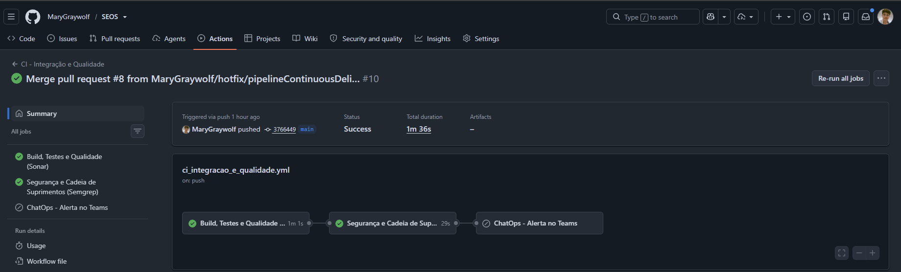
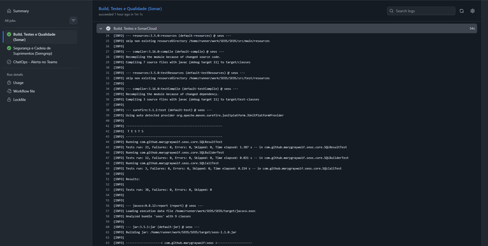
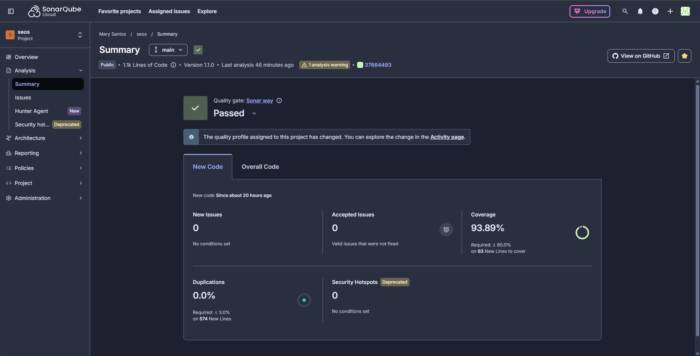
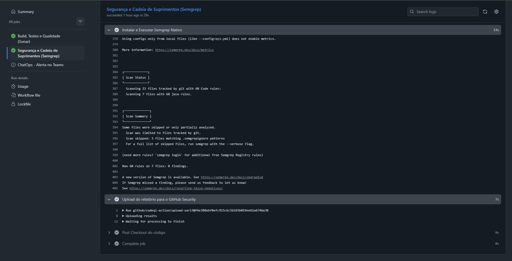
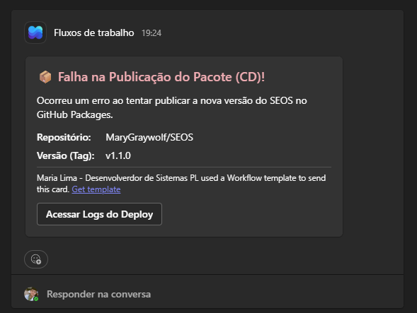
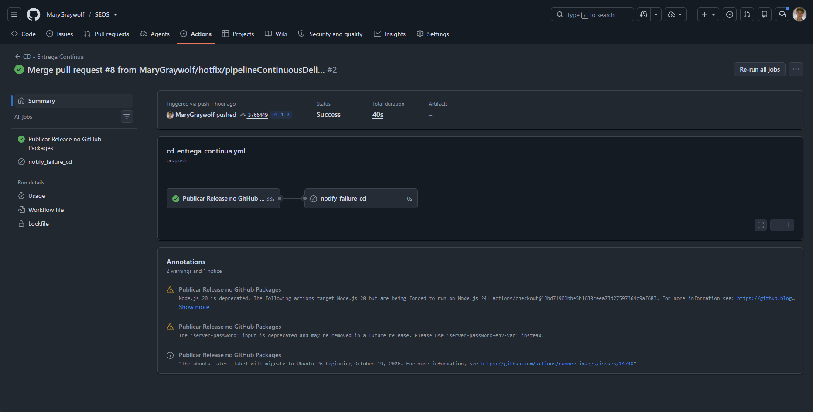
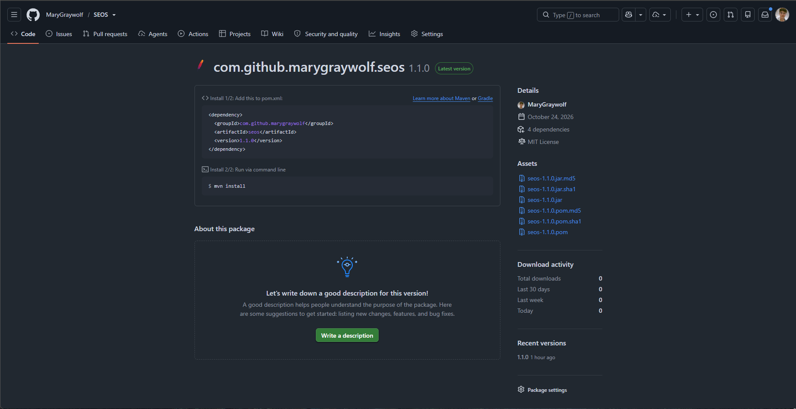

# Relatório de Projeto

## SEOS (Software Endurance Orchestration System): redução de boilerplate, auditoria e segurança cibernética na camada de persistência

**Autora:** Maria Antônia Santos de Lima  
**Instituição:** Fundação Edson Queiroz — Universidade de Fortaleza (UNIFOR)  
**Curso:** Pós-Graduação em Engenharia de Software com foco em DevOps  
**Local:** Fortaleza-CE  
**Ano:** 2026

## 1. Introdução

Atualmente, na empresa onde trabalho, os métodos de consulta utilizados em nossos projetos são muito verbosos. Para realizar uma consulta, é necessário escrevê-la manualmente, armazená-la em uma variável, mapear os parâmetros do `PreparedStatement` e, logo em seguida, mapear o `ResultSet`, campo a campo.

Em alguns casos, as consultas não possuem parâmetros. Em outros, os valores são concatenados diretamente na instrução _Structured Query Language_ (SQL), o que cria uma brecha significativa para _SQL Injection_. Além disso, existem diversas versões de operações como `INSERT`, `UPDATE` e consultas para uma mesma tabela. Isso ocorre porque determinadas implementações precisam de estruturas específicas que não podem ser modificadas, resultando na duplicação de operações semelhantes.

Nesse contexto, foi desenvolvido o **SEOS** (_Software Endurance Orchestration System_), um _microframework_ de Mapeamento Objeto-Relacional (ORM, do inglês _Object-Relational Mapping_) criado para atender às necessidades específicas da empresa. O _framework_ mapeia tabelas, campos e _sequences_ por meio de _annotations_ e constrói estruturas _Data Manipulation Language_ (DML) e _Data Query Language_ (DQL) com base nesses mapeamentos. Dessa forma, busca tornar o acesso ao banco de dados mais padronizado e seguro, além de retornar as classes com os valores já mapeados e prontos para serem utilizados pelas implementações.

## 1.1 Objetivo

### Objetivo geral

Evoluir o _microframework_ SEOS com base em práticas consolidadas de mercado e estruturar seu processo de desenvolvimento sob a cultura _DevSecOps_, a fim de demonstrar os ganhos de otimização, padronização, auditoria e segurança na camada de persistência.

### Objetivos específicos

- **Automatização de persistência:** implementar um mecanismo automatizado de geração de instruções DML/DQL (`SQLBuilder`) e de mapeamento objeto-relacional de `ResultSet` baseado em _annotations_ e _reflection_;
- **Segurança contra injeções:** mitigar riscos de _SQL Injection_ na camada de persistência por meio da parametrização obrigatória de consultas no `PreparedStatement` e validação estrutural das operações;
- **Auditoria e observabilidade:** incorporar recursos para rastreamento de erros, parâmetros e tempo de execução das consultas ao banco de dados;
- **Esteira _DevSecOps_ (CI/CD):** estruturar uma _pipeline_ de Integração Contínua com execução automatizada de testes, análise de cobertura e qualidade (JaCoCo e SonarCloud), análise estática de segurança — _Static Application Security Testing_ (SAST) com Semgrep —, notificações via _ChatOps_ e Entrega Contínua configurando o GitHub Packages com versionamento semântico da biblioteca;
- **Avaliação arquitetural:** avaliar a aderência arquitetural do SEOS frente ao cenário corporativo estudado e em comparação com soluções consolidadas de mercado, como Hibernate/_Java Persistence API_ (JPA);
- **Mensuração de resultados:** mensurar os ganhos quantitativos e qualitativos da adoção do SEOS em relação à abordagem tradicional — _Java Database Connectivity_ (JDBC) manual —, considerando redução de linhas de código, taxa de duplicação e exposição a vulnerabilidades baseadas no _Open Worldwide Application Security Project_ (OWASP) _Top_ 10.

## 1.2 Justificativa

Ao criar uma implementação para atender a uma demanda e perceber que não poderia reutilizar o mesmo método de persistência no banco de dados, a primeira coisa que pensei foi: _“Por que criar mais uma versão de um `UPDATE` com as mesmas condições?”_. Foi nesse momento que percebi que a **falta de padronização**, a **baixa qualidade do código** e os **problemas de segurança nas consultas** eram fatores que precisavam ser tratados.

Por meio dessa necessidade nasceu o **SEOS**, criado para ser uma solução capaz de reduzir o trabalho manual e a duplicação de métodos, facilitar a manutenção dos projetos empresariais e diminuir os riscos de _SQL Injection_, <u>sem retirar da equipe o controle</u> sobre as consultas, conexões e transações de persistência.

## 1.3 Problema

- **21.381** linhas de código;
- **409** métodos, dos quais **402** acessam o banco de dados;
- **19,6%** de linhas idênticas;
- **54,4%** de linhas repetidas;
- Entre **416** chamadas a `PreparedStatement`, apenas **156** utilizam métodos `setXxx()`;
- Aproximadamente **43%** dos métodos são potencialmente vulneráveis a _SQL Injection_.

Esses são os números mapeados juntamente com a equipe de Arquitetura da empresa a partir de <u>um único arquivo _Repository_ de um único projeto</u> utilizado no contexto empresarial. Os alertas sobre o desenvolvimento inadequado de métodos de persistência nos projetos, que possibilitam a ocorrência de _SQL Injection_, já haviam sido repassados; contudo, devido à ausência histórica de uma abstração padronizada, à pressão por entregas rápidas e ao fato de os projetos existentes serem catalogados como legados, tornou-se difícil corrigir e padronizar o desenvolvimento manualmente, e é exatamente nesse cenário que o SEOS se encaixa.

Embora ele atue como uma biblioteca Java distribuída sob versionamento semântico — não sendo uma aplicação final em si —, ele opera no núcleo da camada de persistência dos módulos corporativos que sustentam a operação da empresa. No exemplo citado anteriormente, a presença de aproximadamente **43% de métodos suscetíveis a _SQL Injection_** representa um risco operacional crítico ao banco de dados. A exploração de uma vulnerabilidade dessa natureza, ou a indisponibilidade do sistema devido à corrupção de tabelas essenciais ao fluxo operacional, exigiria um tempo estimado de recuperação de `[INFORMAR_DEPOIS]` para conter e restaurar o ambiente. Nesse intervalo, estima-se um **prejuízo direto** de aproximadamente `[R$ X]` devido à paralisação do faturamento e das vendas, além de **prejuízos indiretos** severos, como perda de clientes e desgaste reputacional. Diante disso, a adoção do SEOS, aliada à esteira _DevSecOps_ e ao controle estrito de versões, atua diretamente na mitigação preventiva desses impactos financeiros e operacionais.

## 2. Referencial Teórico

O projeto utiliza conceitos relacionados a:

- JDBC e acesso a bancos de dados relacionais;
- Mapeamento objeto-relacional (ORM);
- _SQL Injection_ e consultas parametrizadas;
- OWASP _Top_ 10;
- _DevSecOps_;
- Integração e entrega contínuas;
- SAST (_Static Application Security Testing_);
- auditoria e observabilidade de aplicações.

Esta seção deverá ser complementada com a fundamentação dos conceitos e com pelo menos cinco artigos atuais sobre ataques cibernéticos, segurança de aplicações e práticas _DevSecOps_.

## 3. Caso de Uso

### 3.1 Contexto do Trabalho

O cenário utilizado como inspiração e base para o desenvolvimento e a aplicabilidade do SEOS é o de uma empresa têxtil que possui **dois projetos legados principais**. Esses dois sistemas foram desenvolvidos utilizando o ecossistema Java (nas versões 8 e 11), realizando o acesso direto ao banco de dados Oracle 19c via JDBC e comunicando-se via _Application Programming Interface_ (API) com o sistema de _Enterprise Resource Planning_ (ERP) responsável pelo gerenciamento dos processos empresariais. Por razões de confidencialidade e políticas internas de segurança da informação, a identidade da organização e os indicadores corporativos globais são preservados neste relatório, concentrando-se a caracterização no ambiente técnico de engenharia de software.

Esses dois sistemas sustentam rotinas operacionais críticas de diferentes fluxos de negócio da empresa — um responsável por **automações produtivas, logísticas e contábeis**, e o outro responsável pelo **_e-commerce_** —, concentrando um elevado volume de consultas e persistências desenvolvidas ao longo dos anos. Pela forma como os sistemas foram estruturados junto ao ERP, as consultas, as conexões e as transações precisam continuar <u>sob o controle direto da aplicação</u>, o que impedia o uso de um ORM tradicional que gerenciasse tudo de forma automática.

Além disso, como esses dois sistemas evoluíram ao longo de vários anos passando por diferentes desenvolvedores e demandas urgentes de negócio, manter a escrita SQL manual segura e uniforme sem uma ferramenta centralizadora tornou-se um desafio diário. Por conta disso, o SEOS precisou ser pensado como uma biblioteca leve, compatível tanto com o Java 8 quanto com o Java 11, para se encaixar diretamente nos projetos já existentes sem exigir mudanças na arquitetura da empresa.

### 3.2 Situação Atual

Na situação anterior ao SEOS, não havia uma padronização para a camada de persistência nos dois sistemas. O desenvolvedor precisava construir cada instrução SQL manualmente, mapear os parâmetros seja via `PreparedStatement` ou concatenando, percorrer o `ResultSet` campo a campo e tratar possíveis erros por conta própria. Às vezes, eram reaproveitados métodos parecidos para aceleração da demanda, mas, em grande parte dos casos, esses métodos estavam desenvolvidos erroneamente. Para dimensionar o impacto real dessas práticas na totalidade dos dois projetos legados — ampliando a análise inicial daquele arquivo isolado apresentado na Seção 1.3 —, foi realizado um levantamento junto à equipe de Arquitetura analisando todos os métodos que interagem com o banco de dados (totalizando **2.890 métodos** somados entre as duas aplicações).

No primeiro sistema, responsável pelas automações corporativas (produtivas, logísticas e contábeis), foram analisados **1.641 métodos** de acesso ao banco, cujos resultados foram organizados conforme apresentado na Tabela 1:

#### Tabela 1 — Levantamento de métodos de persistência no sistema de automações corporativas

| #   | Indicador                                                                            | Quantidade | % dos 1.641 |
| --- | ------------------------------------------------------------------------------------ | ---------- | ----------- |
| 1   | Métodos que realizam funções no banco                                                | 1.641      | 100%        |
| 2   | Usam conexão JDBC (`PreparedStatement`, `CallableStatement`, `getPreparedStatement`) | 1.321      | 80,5%       |
| 3   | Não usam JDBC direto                                                                 | 320        | 19,5%       |
| 4   | Com alguma má prática de consulta                                                    | **395**    | **24,1%**   |
| 5   | Vulneráveis (concatenam `String` ou tipo não resolvido)                              | **283**    | **17,2%**   |
| 6   | Sem nenhuma chamada de _log_                                                         | **573**    | **34,9%**   |

**Fonte:** Elaborada pela autora (2026).

Dos **573 métodos sem _logs_**, **254** possuem `try/catch` mas não registram _logs_ de erro ou de sucesso, **58** só aplicam `System.out` ou `printStackTrace` e **28** possuem vulnerabilidades. Já no segundo sistema, responsável pelo _e-commerce_, o cenário mostrou-se ainda mais crítico quanto à exposição a _SQL Injection_ e à falta de rastreabilidade, conforme demonstrado na Tabela 2:

#### Tabela 2 — Levantamento de métodos de persistência no sistema de _e-commerce_

| #   | Indicador                                                  | Quantidade | % dos 1.249 |
| --- | ---------------------------------------------------------- | ---------- | ----------- |
| 1   | Métodos que fazem operações no banco                       | 1.249      | 100%        |
| 2   | Usam JDBC (`prepareStatement`, `prepareCall`, `ResultSet`) | 1.229      | 98,4%       |
| 3   | Não usam JDBC (JPA/Hibernate via `EntityManager`)          | 20         | 1,6%        |
| 4   | Fora das boas práticas (concatenam variáveis na SQL)       | **468**    | **37,5%**   |
| 5   | Vulneráveis a _SQL Injection_                              | **299**    | **23,9%**   |
| 6   | Sem auditoria de _logs_                                    | **1.179**  | **94,4%**   |

**Fonte:** Elaborada pela autora (2026).

Abaixo apresenta-se um exemplo claro do que alimentou os dados desses levantamentos:

```java
public List<Usuario> consultarUsuarios(String status, Integer idadeMinima) {
    List<Usuario> listaResultado = new ArrayList<>();

    String dql = "SELECT USER_ID, USER_NAME, USER_AGE, STATUS "
            + "FROM TB_USER WHERE 1=1 ";

    if (status != null && !status.isEmpty()) {
        dql += " AND STATUS = '" + status + "'";
    }
    if (idadeMinima != null) {
        dql += " AND USER_AGE >= " + idadeMinima;
    }

    try (Connection conn = DriverManager.getConnection(URL, USER, PASSWORD);
         PreparedStatement ps = conn.prepareStatement(dql);
         ResultSet rs = ps.executeQuery()) {

        while (rs.next()) {
            Long id = rs.getLong("USER_ID");
            String nome = rs.getString("USER_NAME");
            Integer idade = rs.getInt("USER_AGE");
            String statusRetornado = rs.getString("STATUS");

            Usuario usuario = new Usuario();
            usuario.setId(id);
            usuario.setNome(nome);
            usuario.setIdade(idade);
            usuario.setStatus(statusRetornado);
            listaResultado.add(usuario);
        }
    } catch (SQLException e) {
        System.err.println("Erro ao executar consulta: " + e.getMessage());
        e.printStackTrace();
    }
    return listaResultado;
}
```

Analisando os dados acima e levando em conta o exemplo que os alimenta, reflete-se o quão verboso e vulnerável é o padrão de desenvolvimento aplicado ao longo dos anos de construção desses sistemas, pois, além do volume de código, a concatenação direta de valores na consulta dificulta a padronização e pode permitir _SQL Injection_. A existência de várias implementações semelhantes e a falta de _logs_ de auditoria também aumentam o custo de manutenção.

### 3.3 Solução Proposta

Diante dos números levantados na seção anterior — que evidenciaram o excesso de código manual, o risco de _SQL Injection_ e a ausência de _logs_ nos dois sistemas da empresa —, foi idealizado o **SEOS**: um _microframework_ de ORM dentro do ecossistema Java capaz de resolver essas falhas respeitando a arquitetura existente, sem adicionar complexidade e garantindo maior celeridade no desenvolvimento.

A proposta central do SEOS é automatizar justamente a parte mecânica e propensa a erros do uso do JDBC. Em vez de o desenvolvedor repetir manualmente todo o ciclo de preparação e leitura de dados em cada método, a biblioteca assume a construção segura das instruções, a validação dos parâmetros e a auditoria das execuções, devolvendo os objetos já preenchidos <u>sem retirar da aplicação o controle explícito sobre a conexão e a transação</u>.

Para que essa automação funcione na prática, o ponto de partida do SEOS é o mapeamento das tabelas e dos campos diretamente nas classes de Objeto de Transferência de Dados — _Data Transfer Object_ (DTO) — por meio de _annotations_, inspirado no modelo de mapeamento do JPA/Spring Boot, porém aplicado diretamente aos DTOs por meio das interfaces próprias `@TableDB` e `@ColumnDB`.

Pela `@TableDB`, é sinalizado e identificado o nome da tabela ou da _view_ criada no banco de dados; já pela `@ColumnDB`, é possível informar o nome do campo correspondente naquele objeto de banco e declarar se ele é uma _primary key_ e se possui _sequences_. Um detalhe importante a ser ressaltado é que as _sequences_ informadas entram automaticamente nos construtores de `INSERT`, enquanto atributos da classe que não possuem `@ColumnDB` são ignorados pelas demais funcionalidades do SEOS, conforme demonstrado a seguir:

```java
@TableDB(name = "TB_USER")
public class UserDTO {

    @ColumnDB(
        localName = "USER_ID",
        sequence = "SEQ_TB_USER.NEXTVAL",
        isPrimaryKey = true
    )
    private Long id;

    @ColumnDB(localName = "USER_NAME")
    private String name;

    @ColumnDB(localName = "STATUS")
    private String status;

    @ColumnDB(localName = "USER_AGE")
    private Integer age;
}
```

Com as classes configuradas, é possível utilizar a segunda função da ferramenta, o `SQLBuilder`, que lê as _annotations_ via _reflection_ e monta automaticamente os comandos SQL de DQL e DML. A geração do `SELECT` pode montar uma consulta com todos os campos mapeados da classe de forma direta (`buildSelect`) ou retornar campos específicos de forma fluente (`select`) por meio do método `.campos()`, no qual se informam os nomes dos atributos Java da classe, funcionando da mesma maneira para a cláusula de filtro com `.where()`:

```java
// 1. Geração direta com todos os campos mapeados da classe:
SQLBuilder.buildSelect(UserDTO.class, "STATUS = ?", status);

// 2. Geração fluente selecionando campos específicos da classe:
SQLBuilder.select(UserDTO.class)
          .campos("id", "name")
          .where("STATUS = ?", status)
          .build();
```

Para as operações DML (`INSERT` e `UPDATE`), o `SQLBuilder` aplica o conceito de _Anti-Null_: apenas os atributos que estiverem preenchidos serão persistidos no banco. Dessa forma, não é mais preciso desenvolver métodos diferentes para a mesma tabela, sendo necessário apenas informar a classe com as informações preenchidas.

Quando é utilizado o _builder_ de `INSERT` (`buildInsert`) sem preencher os dados da _primary key_, automaticamente é utilizada a _sequence_ configurada anteriormente no `@ColumnDB`, sendo também possível realizar inserções em lote por meio do método `buildInsertBatch()`:

```java
UserDTO newUser = UserDTO.builder()
                         .name("Maria")
                         .status("ATIVO")
                         .build();

SQLBuilder.buildInsert(newUser);

// Instrução SQL conceitual gerada internamente:
// INSERT INTO TB_USER (USER_ID, USER_NAME, STATUS) VALUES (SEQ_TB_USER.NEXTVAL, ?, ?)
```

Já no _builder_ de `UPDATE` (`buildUpdate`), a ferramenta só dá continuidade à função se, e somente se, forem informadas as condições de filtro (`WHERE`). Sem essa parametrização, é lançada uma exceção ao desenvolvedor, impedindo modificações acidentais sem filtro no banco de dados:

```java
UserDTO updateUser = UserDTO.builder()
                         .name("Maria Antônia")
                         .age(26)
                         .build();

SQLBuilder.buildUpdate(updateUser, "USER_ID = ?", idUser);

// Instrução SQL conceitual gerada internamente:
// UPDATE TB_USER SET USER_NAME = ?, USER_AGE = ? WHERE USER_ID = ?
```

Os comandos DQL e DML construídos, juntamente com a lista ordenada de parâmetros, são encapsulados na classe `SQLResult`. Nela são centralizados o preenchimento seguro dos valores no `PreparedStatement` e o mapeamento dos dados retornados pelo `ResultSet` para as classes configuradas com `@ColumnDB`, além de ser validado previamente se a quantidade de parâmetros informados corresponde à quantidade de _placeholders_ (`?`) existentes nos comandos SQL.

Nas operações de escrita (`INSERT` e `UPDATE`), a execução ocorre principalmente por meio do método `executeUpdate`, que aplica os parâmetros no banco e retorna a quantidade de registros afetados. Contudo, em inserções nas quais a aplicação precisa utilizar imediatamente o identificador recém-gerado pela _sequence_ do Oracle, o método `executeAndReturnId` aproveita a marcação `isPrimaryKey = true` da classe para recuperar a chave primária gerada no banco e preenchê-la diretamente no próprio objeto enviado. Já para cenários de alto volume de dados, o método `executeBatch` processa coleções inteiras de objetos em uma única comunicação em lote com o banco, permitindo que o chamador controle explicitamente o escopo transacional (`commit` e `rollback`) sobre os objetos `newUser` e `updateUser` exemplificados anteriormente:

```java
// 1. Atualização retornando a quantidade de linhas afetadas:
int linhasAtualizadas = SQLBuilder
    .buildUpdate(updateUser, "USER_ID = ?", idUser)
    .executeUpdate(conn);

// 2. Inserção retornando o ID gerado pela sequence (e preenchendo newUser.id):
Long idGerado = SQLBuilder
    .buildInsert(newUser)
    .executeAndReturnId(conn, newUser);

// 3. Inserção em lote com controle transacional explícito pelo chamador:
boolean autoCommitOriginal = conn.getAutoCommit();
try {
    conn.setAutoCommit(false);
    int[] resultados = SQLBuilder.buildInsertBatch(newUsers).executeBatch(conn);
    conn.commit();
} catch (Exception e) {
    conn.rollback();
    throw e;
} finally {
    conn.setAutoCommit(autoCommitOriginal);
}
```

Como já mencionado, a conexão JDBC necessária para a execução dessas funcionalidades parte sempre do chamador; não é responsabilidade do SEOS fechar, confirmar ou reverter a `Connection`, sendo encerrados internamente apenas o `PreparedStatement` e o `ResultSet`.

Nas operações de leitura (`SELECT`), um dos principais gargalos observados nos sistemas legados da empresa era a repetição de laços `while (rs.next())` para extrair manualmente cada coluna do `ResultSet`, independentemente de a consulta retornar uma lista completa de entidades, um único registro, um agrupamento para relatórios ou apenas um contador numérico. Para eliminar essa repetição sem obrigar a equipe a criar classes DTO para todo tipo de consulta, o `SQLResult` foi estruturado em diferentes modalidades de leitura.

Quando a consulta envolve entidades mapeadas da aplicação, a leitura pode ser feita diretamente para objetos tipados por meio dos métodos `executeQuery` e `executeQuerySingle`. Enquanto o primeiro percorre todo o `ResultSet` e instancia automaticamente uma lista da classe informada com base nas anotações `@ColumnDB`, o segundo é voltado a buscas pontuais (como consultas por chave primária), retornando apenas o primeiro registro encontrado ou `null` quando não há correspondência no banco. Além disso, para facilitar a adoção gradual da biblioteca em métodos legados que ainda manipulam o `PreparedStatement` manualmente, o método `mapearResultSet` foi exposto publicamente, permitindo aproveitar o mapeamento automático a partir de um `ResultSet` já aberto:

```java
// 1. Retorno de lista de objetos mapeados:
List<UserDTO> users = SQLBuilder
    .buildSelect(UserDTO.class, "STATUS = ?", status)
    .executeQuery(conn, UserDTO.class);

// 2. Retorno de um único objeto (ou null se não encontrado):
UserDTO user = SQLBuilder
    .buildSelect(UserDTO.class, "USER_ID = ? AND STATUS = ?", idUser, status)
    .executeQuerySingle(conn, UserDTO.class);

// 3. Aproveitamento do mapeamento em consultas legadas com ResultSet aberto:
try (PreparedStatement ps = conn.prepareStatement(sql);
     ResultSet rs = ps.executeQuery()) {
    return new SQLResult(sql, Collections.emptyList()).mapearResultSet(rs, UserDTO.class);
}
```

Por outro lado, em rotinas de relatórios, totalizadores ou consultas parciais nas quais a criação de um DTO específico seria desnecessária, o `SQLResult` permite extrair os dados em estruturas dinâmicas do próprio Java. Nesses cenários, os métodos `executeQueryAsMap` e `executeQueryAsSingleMap` convertem as linhas retornadas em mapas (`Map<String, Object>`) indexados pelo nome da coluna em letras maiúsculas. De modo complementar, o método `executeAsDictionary` transforma consultas de duas colunas diretamente em um dicionário de chave e valor (`Map<K, V>`), facilitando o carregamento de pares como identificador e nome em memória, enquanto o `executeScalar` extrai e converte automaticamente o valor da primeira coluna da primeira linha (tratando, inclusive, o retorno `BigDecimal` padrão do Oracle para tipos como `Integer` ou `Long`):

```java
// 1. Consulta agregada retornando lista de mapas (sem necessidade de DTO):
List<Map<String, Object>> totaisPorStatus = new SQLResult(
    "SELECT STATUS, COUNT(1) TOTAL FROM TB_USER GROUP BY STATUS",
    Collections.emptyList()
).executeQueryAsMap(conn);

// 2. Projeção parcial de uma única linha em mapa:
Map<String, Object> dadosParciais = new SQLResult(
    "SELECT USER_NAME, STATUS FROM TB_USER WHERE USER_ID = ?",
    Arrays.asList(idUser)
).executeQueryAsSingleMap(conn);

// 3. Mapeamento direto de duas colunas em dicionário (chave -> valor):
Map<Long, String> nomesPorId = new SQLResult(
    "SELECT USER_ID, USER_NAME FROM TB_USER WHERE STATUS = ?",
    Arrays.asList("ATIVO")
).executeAsDictionary(conn);

// 4. Retorno de valor escalar único com conversão automática de tipo:
Integer totalAtivos = new SQLResult(
    "SELECT COUNT(1) FROM TB_USER WHERE STATUS = ?",
    Arrays.asList("ATIVO")
).executeScalar(conn, Integer.class);
```

Além das instruções DQL e DML tradicionais, o ambiente Oracle 19c integrado ao ERP concentra diversas regras de negócio dentro do próprio banco por meio de _procedures_ e _packages_ escritas em _Procedural Language/Structured Query Language_ (PL/SQL). Na abordagem manual com `CallableStatement`, a invocação dessas rotinas exigia a montagem da sintaxe `{call ...}`, o controle manual da posição numérica de cada parâmetro e a leitura dos valores de saída também por índice, aumentando a incidência de erros de manutenção. Para padronizar esse fluxo, foi desenvolvida a classe `SQLCall`, que oferece uma interface fluente para declarar o nome da _procedure_ (`.name()`) e registrar parâmetros de entrada (`.in()`), de saída (`.out()`) ou mistos (`.inOut()`), associando os retornos a apelidos legíveis (_aliases_) que podem ser recuperados de forma tipada após a execução:

```java
SQLCall.Result resultado = SQLCall
    .name("PKG_USER.PROCESSAR_CADASTRO")
    .in(newUser.getName())
    .inOut("STATUS_ATUAL", newUser.getStatus(), Types.VARCHAR)
    .out("ID_GERADO", Types.NUMERIC)
    .execute(conn);

Long idGerado = resultado.getLong("ID_GERADO");
String statusFinal = resultado.getString("STATUS_ATUAL");
```

Por fim, para solucionar a grave ausência de rastreabilidade apontada na Seção 3.2 — na qual **34,9%** dos métodos do sistema de automações e **94,4%** dos métodos do _e-commerce_ não possuíam nenhum registro de _log_ —, o SEOS incorporou uma camada transversal de auditoria e observabilidade baseada na interface _Service Provider Interface_ (SPI) `OrmLogger`, gerenciada globalmente pela classe `OrmConfig`. Por meio dessa estrutura, todas as execuções realizadas pelo `SQLResult` e pelo `SQLCall` têm seu tempo de resposta cronometrado automaticamente e inspecionam a pilha de execução da _thread_ (`StackTraceElement`) para identificar exatamente a classe e o método da aplicação que originaram a chamada ao banco. Quando ocorre qualquer exceção SQL ou quando uma operação ultrapassa o limite de tempo configurado — **10 segundos** para consultas no `SQLResult` e **3 segundos** para chamadas PL/SQL no `SQLCall` —, a biblioteca registra automaticamente o alerta com a origem da chamada, o tempo decorrido e a quantidade de parâmetros enviados, permitindo que os sistemas legados conectem seu próprio mecanismo de _logs_ na inicialização da aplicação:

```java
// Integração opcional do logger da aplicação com a auditoria automática do SEOS:
OrmConfig.setLogger(new OrmLogger() {
    @Override
    public void info(String origin, String code, String msg, Object... params) {
        appLogger.info("{} [{}] {}", origin, code, msg);
    }

    @Override
    public void warn(String origin, String code, String msg, Object... params) {
        appLogger.warn("{} [{}] {}", origin, code, msg);
    }

    @Override
    public void error(String origin, String code, String msg, Exception e, Object... params) {
        appLogger.error("{} [{}] {}", origin, code, msg, e);
    }
});
```

### 3.4 Vantagens e desvantagens

As vantagens de adotar o SEOS é a garantia de um processo mais simplificado e seguro para realizar operações transacionais em banco de dados sem afetar o controle interno de conexões JDBC e a performance da aplicação, graças aos seus métodos que mapeiam parametros e resultados via reflections os riscos de expor o produto a um SQL Injection são mitigados. Em suma, a arquitetura do framework consolida-se em quatro pilares fundamentais: Padronização, Simplificação, Proteção e Reutilização.

Como limitações, o SEOS mantém parte do controle explícito no código da aplicação. Relacionamentos, _joins_, conexões e transações não são gerenciados automaticamente pelo framework. Essas características devem ser avaliadas em conjunto com as necessidades do ambiente empresarial.

### 3.5 Comparação com Hibernate/JPA

Antes de começar a implementar o SEOS no ambiente da empresa, foi realizada uma comparação com o Hibernate, uma das soluções ORM mais utilizadas no ecossistema Java.

| Requisito do projeto         | Hibernate / JPA                                                                         | SEOS híbrido JDBC                                                                  | Adequação ao cenário atual                                       |
| ---------------------------- | --------------------------------------------------------------------------------------- | ---------------------------------------------------------------------------------- | ---------------------------------------------------------------- |
| Integração com conexões ERP  | Requer configurar e integrar o contexto de persistência ao ciclo da plataforma.         | Recebe diretamente a `Connection` já fornecida pela aplicação.                     | O SEOS preserva o modelo operacional existente.                  |
| Previsibilidade das escritas | O resultado depende do estado da entidade, do contexto e das configurações de `flush`.  | Cada chamada representa um comando visível, sem sincronização implícita posterior. | O SEOS facilita a rastreabilidade nos projetos.                  |
| SQL Oracle específico        | Pode ser usado por SQL nativo, paralelamente ao modelo de entidades.                    | É parte natural da API e permanece concentrado na camada de `Repository`.          | O SEOS evita manter duas formas de consulta para o mesmo módulo. |
| CRUD de tabelas customizadas | Exige mapear entidades e configurar o ambiente JPA.                                     | Exige DTO anotado e _builders_ diretos.                                            | O SEOS atende com menor superfície de configuração.              |
| Atualizações parciais        | Possui alternativas como entidade gerenciada, consultas específicas e `@DynamicUpdate`. | A estratégia Anti-Null transforma o DTO parcial diretamente no `SET`.              | O SEOS expressa de forma simples o padrão recorrente do projeto. |
| Controle transacional        | Integra-se a JTA, Spring e outros gerenciadores quando disponíveis.                     | Usa `commit`, `rollback` e conexão definidos pelo chamador.                        | O SEOS participa do limite transacional adotado pelo projeto.    |
| Consultas e projeções        | Oferece JPQL, Criteria, SQL nativo e projeções.                                         | Oferece DTO, resultado único, escalar, mapa, dicionário e SQL explícito.           | A API atual cobre os formatos utilizados pelos DAOs.             |
| Relacionamentos de domínio   | Automatiza associações, cascatas e estratégias de carregamento.                         | Mantém _joins_ e composição de resultados explícitos.                              | O escopo atual privilegia operações objetivas.                   |
| Dependências e inicialização | Requer o _runtime_ e a configuração do provedor ORM.                                    | Utiliza JDBC e poucas classes utilitárias já incorporadas ao projeto.              | O SEOS acrescenta baixo _overhead_ à implantação.                |
| Diagnóstico                  | Possui ecossistema de logs e métricas, sujeito à configuração adotada.                  | Concentra SQL e parâmetros e audita erros, origem e consultas lentas.              | A observabilidade atende ao diagnóstico necessário.              |

### 3.6 Quadro de respostas — antes e depois

Este quadro deverá ser preenchido após a execução das avaliações:

| Critério                                      | Antes do SEOS                            | Depois do SEOS                 |
| --------------------------------------------- | ---------------------------------------- | ------------------------------ |
| Linhas de código                              | 21.381 linhas no `ProjectDAO` analisado. | A preencher.                   |
| Linhas repetidas                              | 54,4%.                                   | A preencher.                   |
| Linhas idênticas                              | 19,6%.                                   | A preencher.                   |
| Chamadas a `PreparedStatement` com `setXxx()` | 156 de 416 chamadas.                     | A preencher.                   |
| Métodos potencialmente vulneráveis            | Aproximadamente 43%.                     | A preencher.                   |
| Mapeamento do `ResultSet`                     | Manual, campo a campo.                   | Realizado pelo SEOS.           |
| Construção das consultas                      | Manual e distribuída nos métodos.        | Padronizada pelo `SQLBuilder`. |

### 3.7 Resultado

Até o momento, foram identificadas a necessidade de padronização da camada de persistência, a redução de código repetitivo e a necessidade de ampliar os mecanismos de segurança. Os resultados quantitativos da aplicação do SEOS ainda deverão ser registrados nesta seção.

### 3.8 Recomendações — plano de aplicação DevSecOps

O projeto será estruturado com base nas seguintes práticas:

1. **Integração Contínua (Continuous Integration):** o workflow [`devsecops.yml`](.github/workflows/devsecops.yml) é executado em _push_ na branch `main` ou quando uma _pull request_ é aberta para essa branch. O GitHub Actions configura o JDK 11, executa `mvn clean verify`, compila a aplicação e executa os testes automatizados com JUnit 5 e Mockito. O JaCoCo coleta os dados dos testes e gera o relatório de cobertura.





2. **Qualidade Contínua (Continuous Quality):** a pipeline envia os resultados dos testes e da cobertura para o SonarCloud. A ferramenta analisa cobertura, duplicação, _bugs_, vulnerabilidades e _code smells_. O _Quality Gate_ verifica os critérios definidos e pode reprovar a alteração antes da integração da _pull request_.



3. **Segurança Antecipada (Shift-Left Security):** após a compilação, os testes e a análise de qualidade, o Semgrep realiza uma análise estática de segurança (SAST) no código Java do SEOS. O resultado é gerado em formato SARIF e enviado ao GitHub Security. As versões das dependências utilizadas na etapa são fixadas por _hash_ e a instalação de pacotes binários desconhecidos é restringida por `--only-binary :all:`.



4. **Observabilidade e ChatOps:** a pipeline possui um mecanismo de notificação assíncrona que aciona um alerta via _Webhook_ integrado ao Microsoft Teams quando uma etapa anterior falha. A mensagem informa a etapa, o projeto, o motivo e um link para os logs da execução.



5. **Entrega Contínua (Continuous Delivery):** esta etapa deverá ser detalhada com o fluxo de publicação, implantação e validação adotado pelo projeto.





### 3.9 Dados do Projeto

Os dados já levantados são:

- 21.381 linhas de código no `ProjectDAO` analisado;
- 409 métodos, dos quais 402 acessam o banco de dados;
- 19,6% de linhas idênticas;
- 54,4% de linhas repetidas;
- 416 chamadas a `PreparedStatement`;
- 156 chamadas que utilizam métodos `setXxx()`;
- aproximadamente 43% de métodos potencialmente vulneráveis a SQL Injection.

Ainda devem ser informados a quantidade de pessoas envolvidas, o volume total de trabalho, o período de desenvolvimento e a quantidade de módulos ou consultas analisados.

## 4. Conclusão

Esta seção será preenchida após a conclusão das avaliações. Deverá retomar o problema identificado, apresentar os resultados do SEOS, discutir suas limitações e indicar possíveis trabalhos futuros.

## 5. Referências

As referências bibliográficas deverão ser incluídas após a seleção das fontes utilizadas no referencial teórico e na análise de segurança.

## 6. Anexos

### Anexo A — Questionário baseado no OWASP Top 10

O questionário deverá ser incluído nesta seção e suas respostas deverão ser relacionadas ao quadro de respostas apresentado na seção 3.6.
